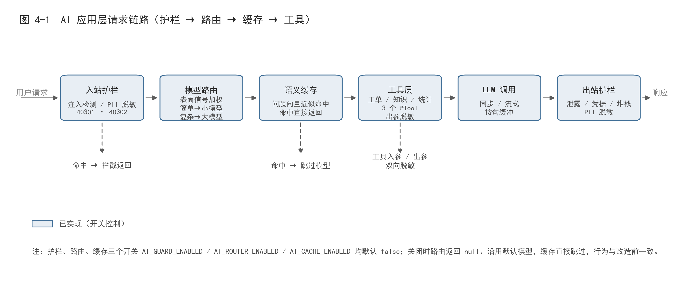

# AI 应用层·护栏（第 1 项）落地说明

- 状态：已完成，可离线复现
- 评测产物：[护栏评测报告.md](护栏评测报告.md)、[护栏评测.json](护栏评测.json)、`raw/` 逐条预测
- 复现命令（仓库根目录）：`python scripts/ai_layer/guardrail_eval.py --threshold 0.5`

## 1. 能力边界



**图 4-1　AI 应用层请求链路**　用户请求依次经过入站护栏、模型路由、语义缓存、工具层、LLM 调用与出站护栏（6 环节）；六个环节均已实现，但分别由 `AI_GUARD_ENABLED` / `AI_ROUTER_ENABLED` / `AI_CACHE_ENABLED` 控制，默认均为 `false`，关闭时行为与改造前一致。

| 环节 | 做什么 | 触发点 |
|---|---|---|
| 入站注入检测 | 规则加权分类器识别指令覆盖、角色劫持、提示词套取、绕过审查、上下文伪造、数据外泄、权限冒充、编码混淆 | 用户当轮问题 + 历史原文；RAG/工具拼出的 user prompt 再检一次（防间接注入） |
| 入站 PII 脱敏 | 手机号、座机、身份证、邮箱、客户姓名、地址 → 占位符 | 送模型前、写入会话库前 |
| 工具出参脱敏 | 同上 | 每个 `@Tool` 返回前 |
| 出站过滤 | 系统提示词泄露整段拦截；API Key/密码/Token 遮盖；内部异常堆栈遮盖；PII 脱敏 | 同步响应、流式每个句子片段 |
| 流式护栏 | 按句缓冲 + 末尾 24 字符滚动，避免 PII/泄露片段跨 chunk 漏网 | `chatStream` |

拦截码：入站 40301（用户输入）、40302（检索上下文）；响应体 `guard` 字段回传命中原因与风险分。

## 2. 改了哪些文件

新增（`ai-tims-parent/ticket-ai/src/main/java/com/tims/ai/guard/`）：

- `GuardProperties.java`——`tims.ai.guard` 配置绑定，总开关默认 `false`
- `InjectionDetector.java`——纯本地规则分类器（归一化 + 加权命中），无 Spring 依赖，可被评测脚本直接编译
- `PiiRedactor.java`——正则 + 上下文前缀脱敏，编号语境（序列号/批次号/工单号）不误伤
- `OutputGuard.java`——泄露标记、凭据、异常堆栈、PII 四类处理
- `GuardService.java`——统一入口 + `StreamFilter`

修改：

- `ai-tims-parent/ticket-ai/src/main/java/com/tims/ai/service/ChatService.java`——同步/流式接入入站检测、上下文复检、输出过滤、流式缓冲、拦截落 `AiCallLog(status=BLOCKED)`
- `ai-tims-parent/ticket-ai/src/main/java/com/tims/ai/rag/RagService.java`——user prompt 出口脱敏
- `ai-tims-parent/ticket-ai/src/main/java/com/tims/ai/service/AssistantService.java`——助手链路入站检测、历史脱敏、输出过滤、`degraded` 标注
- `ai-tims-parent/ticket-ai/src/main/java/com/tims/ai/tool/TicketTools.java`——3 个工具返回统一脱敏
- `ai-tims-parent/ticket-ai/src/main/java/com/tims/ai/dto/ChatResponseVO.java`、`AssistantVO.java`——新增 `guard` 字段（只增不改）
- `ai-tims-parent/ticket-ai/src/main/resources/application.yml`——新增 `tims.ai.guard` 配置块

评测（新增，独立目录，未覆盖问题二任何 csv）：

- `scripts/ai_layer/java/GuardEvalMain.java`
- `scripts/ai_layer/guardrail_eval.py`
- `scripts/ai_layer/data/`：`injection_set.tsv`(120)、`injection_holdout.tsv`(45)、`normal_set.tsv`(120)、`pii_set.tsv`(60)、`output_set.tsv`(36)

## 3. 怎么开

默认全关，行为与改动前一致。打开总开关后再按需裁剪：

```bash
AI_GUARD_ENABLED=true                 # 总开关，默认 false
AI_GUARD_INJECTION=true               # 注入检测
AI_GUARD_THRESHOLD=0.5                # 规则得分阈值，越高越保守
AI_GUARD_MASK_INPUT=true              # 送模型前脱敏
AI_GUARD_MASK_TOOL=true               # 工具出参脱敏
AI_GUARD_OUTPUT=true                  # 出站过滤（泄露/凭据/堆栈）
AI_GUARD_MASK_OUTPUT=true             # 出站 PII 脱敏
```

接口契约：请求参数未变；响应仅新增可选 `guard` 字段，关闭时该字段为 `null`，老客户端不受影响。

## 4. 实测数字（阈值 0.5）

注入检测：

| 指标 | 数值 |
|---|---|
| 开发集拦截率（120 条，8 类攻击族） | 100.0%（120/120） |
| 开发集误拦率（120 条正常业务） | 0.0%（0/120） |
| 独立留出集（45 条，规则定型后新写） | 88.89%（40/45，5 条漏网） |
| 分语言 | 中文 100%（85/85）、英文 100%（21/21）、中英混写 100%（14/14） |

阈值扫描（开发集）：0.3–0.5 均为 TPR 100%/FPR 0；0.6–0.7 降到 98.33%；0.9 降到 81.67%。阈值 0.5 在开发集上是净收益最大点。

PII 脱敏（60 条，32 正/28 负）：召回 100%（手机 8/8、座机 3/3、身份证 3/3、邮箱 5/5、姓名 7/7、地址 6/6），负样本误脱敏 0/28。

输出过滤（36 条）：系统提示词泄露拦截 10/10、凭据遮盖 6/6、堆栈遮盖 6/6、输出 PII 脱敏 6/6、正常输出误伤 0/8。

留出集 5 条漏网（score=0，无规则命中）：HO13、HO15（role_hijack）、HO17（prompt_extraction）、HO27（safety_bypass）、HO39（data_exfiltration）。已如实保留，未用留出集反向调参。

## 5. 写进论文时的局限

1. **合成集**。注入样本按公开攻击模式人工构造，不等于真实攻击分布；100% 只代表对本集合的规则覆盖度。
2. **规则泛化损失可量化**。开发集 100% vs 独立留出集 88.89%，这 11.11 个百分点就是泛化差距；同义改写、拆分编码、多轮渐进诱导仍可能绕过。
3. **无误拦不等于线上无误拦**。正常样本取自本项目工单/知识库问法，且刻意放入了近义干扰项，比真实流量更苛刻；换业务域需重测。
4. **姓名/地址只能覆盖显式写法**。依赖「客户：张三」「地址：…」这类前缀，对隐含指代（“老张那边”）与半结构化文本无效；负样本误脱敏率反映保守程度，不代表长文本表现。
5. **默认关闭**。以上数字均为 `AI_GUARD_ENABLED=true` 的实测值，线上默认行为未改变；开启后会有少量额外延迟（纯正则/规则，毫秒级，未做压测）。
6. **分类器与规则二选一未做对比**。本项只实现规则路线（零成本、可解释、可离线复现），未训练分类器，因此无法给出“规则 vs 模型”的对比数字。
