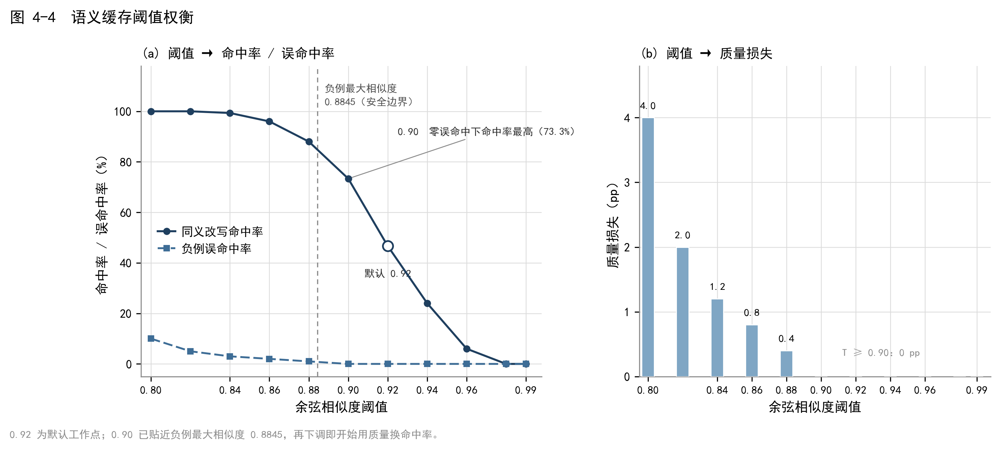

# AI 应用层·语义缓存评测报告

- 生成时间：2026-11-07 09:07:35
- 数据：`scripts/ai_layer/data/cache_set.tsv`，50 族 × 6 行 = 300 条；回放查询 250 条（同义改写 150、近邻负例 50、无关对照 50）
- 答案模型：`glm-5.3-flash`；向量模型：`embedding-3`；计价来自 `application.yml` 的 `tims.ai.model-prices`
- 本轮实跑 300 次模型调用，实测费用 **0.1567 元**（含 50 条预热）
- 判分：规格里的数值片段必须全部出现在答案中；缓存命中时返回的是**同族标准问法的答案**

## 1. 结论

- 默认阈值 `0.92`：同义改写命中 **46.67%**，负例误命中 **0.0%**，准确率 100.0%（无缓存 100.0%），质量损失 **0.0 pp**
- 零错误命中的阈值里，`0.9` 命中率最高（73.33%）；首次出现错误命中的阈值是 `0.8`。默认值仍取更保守的 `0.92`，把安全边际留在 0.92 与负例最大值之间
- 预热阶段 50 条标准问法的答案本身正确 50/50（100.0%）；这一项是缓存质量的天花板
- 精确 hash 基线：命中 0 条（同义改写按定义为 0），质量损失 0.0 pp
- 理想上界（只命中改写、不命中负例）：质量损失 0.0 pp，省 150 次调用 / 0.0769 元

## 2. 阈值扫描（0.80–0.99）

**图 4-4　语义缓存阈值权衡**　左：同义改写命中率与负例误命中率随余弦阈值的变化；右：对应的答案质量损失。0.92 为默认工作点，0.90 已贴近负例最大相似度 0.8845，再下调即开始误命中。数据来源：`docs/paper/ai应用层/缓存评测.json`（回放 250 条查询：同义改写 150 / 近邻负例 50 / 无关对照 50）；n=250。

| 阈值 | 改写命中率 | 负例误命中率 | 命中数 | 准确率 | 无缓存准确率 | 质量损失 | 省下调用 | 省下费用（元） | 命中延迟（ms） | 未命中延迟（ms） |
|---|---|---|---|---|---|---|---|---|---|---|
| 精确 hash | 0.0% | 0.0% | 0 | 100.0% | 100.0% | 0.0 pp | 0 | 0 | 0 | 5970 |
| 0.80 | 100.0% | 10.0% | 160 | 96.0% | 100.0% | 4.0 pp | 160 | 0.0821 | 280 | 6186 |
| 0.82 | 100.0% | 5.0% | 155 | 98.0% | 100.0% | 2.0 pp | 155 | 0.0795 | 280 | 6090 |
| 0.84 | 99.33% | 3.0% | 152 | 98.8% | 100.0% | 1.2 pp | 152 | 0.0778 | 281 | 6092 |
| 0.86 | 96.0% | 2.0% | 146 | 99.2% | 100.0% | 0.8 pp | 146 | 0.0748 | 281 | 6045 |
| 0.88 | 88.0% | 1.0% | 133 | 99.6% | 100.0% | 0.4 pp | 133 | 0.0682 | 281 | 5949 |
| 0.90 | 73.33% | 0.0% | 110 | 100.0% | 100.0% | 0.0 pp | 110 | 0.0562 | 284 | 6131 |
| 0.92 | 46.67% | 0.0% | 70 | 100.0% | 100.0% | 0.0 pp | 70 | 0.0354 | 284 | 5981 |
| 0.94 | 24.0% | 0.0% | 36 | 100.0% | 100.0% | 0.0 pp | 36 | 0.0176 | 283 | 5906 |
| 0.96 | 6.0% | 0.0% | 9 | 100.0% | 100.0% | 0.0 pp | 9 | 0.0042 | 290 | 5990 |
| 0.98 | 0.0% | 0.0% | 0 | 100.0% | 100.0% | 0.0 pp | 0 | 0 | 0 | 5970 |
| 0.99 | 0.0% | 0.0% | 0 | 100.0% | 100.0% | 0.0 pp | 0 | 0 | 0 | 5970 |
| oracle | 100.0% | 0.0% | 150 | 100.0% | 100.0% | 0.0 pp | 150 | 0.0769 | 281 | 6312 |

**相似度分布**：同义改写 min 0.8292 / p10 0.8774 / 中位 0.9179 / max 0.9712；负例 max 0.8845 / p90 0.7986 / 中位 0.6363。
两条分布的重叠区决定了阈值上限：把阈值压到改写 min 以下，必然开始误命中负例。

## 3. 命中但答错（逐条可查）

默认阈值 `0.92` 下共 **0 条**；阈值降到 0.80 时开始出现错误命中，详见下表。

### 3.1 各阈值错误命中计数

| 阈值 | 命中但答错 | 其中负例误命中 | 质量损失 |
|---|---|---|---|
| 0.80 | 10 | 10 | 4.0 pp |
| 0.82 | 5 | 5 | 2.0 pp |
| 0.84 | 3 | 3 | 1.2 pp |
| 0.86 | 2 | 2 | 0.8 pp |
| 0.88 | 1 | 1 | 0.4 pp |
| 0.90 | 0 | 0 | 0.0 pp |
| 0.92 | 0 | 0 | 0.0 pp |
| 0.94 | 0 | 0 | 0.0 pp |
| 0.96 | 0 | 0 | 0.0 pp |
| 0.98 | 0 | 0 | 0.0 pp |
| 0.99 | 0 | 0 | 0.0 pp |

### 3.2 默认阈值 0.92 的逐条明细

无（0 条）。

### 3.3 全量错误命中（任意阈值 ≥0.80 曾命中，逐条可查）

| 行 | 类型 | 设备 | 问题 | 命中的标准问法 | 最高相似度 | 命中阈值 | 缺失规格值 | 缓存答案（截断） |
|---|---|---|---|---|---|---|---|---|
| F12-N | hard_neg | 贴合机 | 「贴合机」的贴合辊表面辊面粗糙度规格要求是多少？ | 「贴合机」的贴合辊与背辊辊间平行度规格要求是多少？ | 0.8845 | 0.80/0.82/0.84/0.86/0.88 | 0.4 | **结论：** 贴合辊与背辊的辊间平行度规格要求为 **≤0.02 mm/m**。

**依据：** 资料明确标注于贴合机档案 LA-N06，指标为辊间平行度，规格上限 0.02 mm/m。超出该值需按规程调整或报修。 |
| F01-N | hard_neg | 蚀刻机 | 请问蚀刻机的排液管路与阀门，排液流量标准是多少？ | 请问蚀刻机的废液液位与排液管路，废液液位标准是多少？ | 0.8736 | 0.80/0.82/0.84/0.86 | 85 | 结论：废液液位须低于高液位的 80%。

依据：蚀刻机（ET-S08）资料中“废液液位与排液管路”部件规定，指标为废液液位，规格要求为低于高液位 80%。建议日常巡检时按此标准监控，防止废液溢出。 |
| F25-N | hard_neg | AOI检测机 | 请问AOI检测机的相机镜头与对焦机构，对焦偏差标准是多少？ | 请问AOI检测机的相机与光源，漏检率标准是多少？ | 0.8436 | 0.80/0.82/0.84 | 0.02 | 结论：AOI检测机的相机与光源，漏检率规格要求为 **≤0.1%**。

依据：来源资料“AOI检测机 / AO-S02”，指标为漏检率，部件为相机与光源。 |
| F36-N | hard_neg | 贴片机 | 「贴片机」的元件相机与标定板标定偏差规格要求是多少？ | 「贴片机」的元件相机与同轴光源图像灰度对比度规格要求是多少？ | 0.8296 | 0.80/0.82 | 0.02 | **结论：** 贴片机元件相机与同轴光源的图像灰度对比度要求为**灰度差 ≥35**。

**依据：** 资料来源「贴片机 / PM-S05」，指标为图像灰度对比度，规格明确灰度差须不低于 35。 |
| F42-N | hard_neg | 贴合机 | 「贴合机」的贴合辊与背辊辊间平行度规格要求是多少？ | 「贴合机」的送料轮与压紧轮送料长度偏差规格要求是多少？ | 0.8257 | 0.80/0.82 | 0.02 | **结论：送料长度偏差规格要求为 ≤0.2 mm。**

依据：参考资料标明贴合机（LA-N14）中送料轮与压紧轮部件的送料长度偏差指标，规格要求为 ≤0.2 mm。 |
| F37-N | hard_neg | 波峰焊 | 请问波峰焊的预热区温控，板面预热温度标准是多少？ | 请问波峰焊的预热风道与过滤网，出风口风速标准是多少？ | 0.8193 | 0.80 | 90/120 | 结论：预热风道与过滤网的出风口风速标准为偏差 ≤10%（以基准值为参照）。

依据：参考资料（来源：波峰焊 / WF-N23）仅给出偏差 ≤10% 的要求，未注明基准风速的具体数值，故无法提供绝对风速值；如需判定合格，需先确认设备规定的基准风速。 |
| F06-N | hard_neg | 贴片机 | 「贴片机」的XY 轴导轨与同步带重复定位精度规格要求是多少？ | 「贴片机」的轨道宽度调节机构与皮带轨道平行度规格要求是多少？ | 0.8184 | 0.80 | 0.03 | **结论**：轨道平行度规格要求为 **≤0.10 mm**。

**依据**：来源「贴片机 / PM-S07」，部件为轨道宽度调节机构与皮带，指标为轨道平行度，规格要求 ≤0.10 mm。 |
| F46-N | hard_neg | 贴片机 | 「贴片机」的吸嘴与反吹回路真空流量规格要求是多少？ | 请问贴片机的真空破坏阀与吸嘴，破真空时间标准是多少？ | 0.8045 | 0.80 | 20 | **结论：** 破真空时间规格要求为 **≤0.10 秒**。

**依据：** 来源“贴片机 / PM-N09”中，真空破坏阀与吸嘴部件的破真空时间指标明确规定为 ≤0.10 s。建议按此标准进行点检或校验。 |
| F15-N | hard_neg | AOI检测机 | 请问AOI检测机的模型库与程序配置，模型版本一致性标准是多少？ | 「AOI检测机」的程序位号与元件库模板匹配率规格要求是多少？ | 0.8039 | 0.80 | 100 | 模板匹配率规格要求为 **≥99%**。

依据：AOI检测机（AO-N02）规格资料中，“程序位号与元件库”部件的“模板匹配率”指标明确要求不低于99%。 |
| F41-N | hard_neg | 蚀刻机 | 请问蚀刻机的废液液位与排液管路，废液液位标准是多少？ | 帮我查一下蚀刻机排液管路与阀门的排液流量指标要求。 | 0.8029 | 0.80 | 80 | **结论**：蚀刻机排液管路与阀门的排液流量规格要求为 **≥标称 85%**。

**依据**：来自蚀刻机资料 ET-N08（部件：排液管路与阀门；指标：排液流量）。

如需该指标的具体测试方法或标称流量值，当前资料未提供，请补充相关文档。 |

相似度最高的负例（即使未命中，也列出供核查）：

| 行 | 类型 | 相似度 | 问题 | 会在哪些阈值命中 |
|---|---|---|---|---|
| F12-N | hard_neg | 0.8845 | 「贴合机」的贴合辊表面辊面粗糙度规格要求是多少？ | 0.8/0.82/0.84/0.86/0.88 |
| F01-N | hard_neg | 0.8736 | 请问蚀刻机的排液管路与阀门，排液流量标准是多少？ | 0.8/0.82/0.84/0.86 |
| F25-N | hard_neg | 0.8436 | 请问AOI检测机的相机镜头与对焦机构，对焦偏差标准是多少？ | 0.8/0.82/0.84 |
| F36-N | hard_neg | 0.8296 | 「贴片机」的元件相机与标定板标定偏差规格要求是多少？ | 0.8/0.82 |
| F42-N | hard_neg | 0.8257 | 「贴合机」的贴合辊与背辊辊间平行度规格要求是多少？ | 0.8/0.82 |
| F37-N | hard_neg | 0.8193 | 请问波峰焊的预热区温控，板面预热温度标准是多少？ | 0.8 |
| F06-N | hard_neg | 0.8184 | 「贴片机」的XY 轴导轨与同步带重复定位精度规格要求是多少？ | 0.8 |
| F46-N | hard_neg | 0.8045 | 「贴片机」的吸嘴与反吹回路真空流量规格要求是多少？ | 0.8 |
| F15-N | hard_neg | 0.8039 | 请问AOI检测机的模型库与程序配置，模型版本一致性标准是多少？ | 0.8 |
| F41-N | hard_neg | 0.8029 | 请问蚀刻机的废液液位与排液管路，废液液位标准是多少？ | 0.8 |

完整逐条明细（每个阈值的错误命中、全部负例相似度）见 `缓存评测.json` 的 `wrong_hits_by_threshold`、`wrong_hit_index` 与 `false_hit_candidates`。

## 4. 成本与延迟

- 无缓存：250 次模型调用，实测 0.1304 元，平均 5970 ms（含向量化）
- 默认阈值：省下 70 次调用 / 0.0354 元；命中平均 284 ms，未命中平均 5981 ms
- 向量费用：embedding-3 已购 5000 万专属包，application.yml 单价记 0，本轮向量费用按 0 计；若按标准价另算，embedding-3 单价需以账单为准，本报告不计

## 5. 局限

1. 评测只回放了「标准问法预热 + 单次查询」，没有模拟多轮里缓存条目持续增长后的相互干扰；线上条目上限与 TTL 见配置。
2. 生产实现的缓存桶还带「检索上下文指纹」（租户 + 工单 + 知识引用 + 历史）；本评测按同桶处理，因此负例误命中率是**上界**，线上会更低。
3. 命中直接复用旧答案，若知识库在 TTL 内更新，用户会看到旧结论；这是缓存的固有代价，需要靠 TTL 与知识发布时的失效策略控制。
4. 单实例进程内缓存；多实例部署时各实例独立命中，命中率按实例计，不共享。
5. 质量判定只看规格数值是否出现，不判表述是否完整、是否存在额外错误信息。

## 6. 接口与开关

- 开关：`AI_CACHE_ENABLED=true`（默认 false）；阈值 `AI_CACHE_THRESHOLD`（默认 0.92）；TTL `AI_CACHE_TTL_SECONDS`；容量 `AI_CACHE_MAX_ENTRIES`
- 同步响应新增可选字段 `cache`：命中 `{hit:true, similarity, exact, matchedQuestion, ageSeconds, threshold}`，未命中 `{hit:false, threshold}`；关闭时不返回该字段
- 流式 SSE：`meta` 事件带同一个 `cache` 对象；`usage` 事件带 `cacheHit` 与 `cacheSimilarity`
- 观测：命中调用在 `ai_call_log` 落一行 `status=CACHE_HIT`、token 计 0，可直接算命中率与省下的费用
