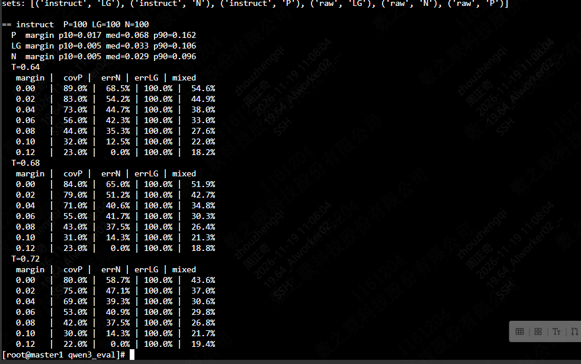

# Qwen3-Embedding 门控阈值实测结果（310 库三池扫描）

> 执行日期：2026-11-19 ｜ 执行位置：公司内网执行机（可访问 `http://172.27.26.253:18893/v1/embeddings`）
> 模型 / 维度：`Qwen/Qwen3-Embedding-8B`，`dimensions=1024` ｜ 知识库：310 条 PUBLISHED
> 样本：正例 100 + leave-gold-out 100 + 负例 100（负例有效 87）
> 上游执行包：[Qwen3Embedding阈值重标定.md](Qwen3Embedding阈值重标定.md) ｜ 历史基线：[门控基线B0.md](门控基线B0.md)、[知识库310敏感性对照.md](知识库310敏感性对照.md)
> 原始输出：留在执行机 `/tmp/qwen3_eval/qwen3_out/`（逐条 CSV 未回传）；本文数字取自本次运行的控制台表与 `qwen3_gate_summary.json` 摘录，未做二次改写
> 2026-11-23 切片复算与 `gateEnabled` 排查：[门控切片复算_20261123.md](门控切片复算_20261123.md)（同一 600 行 CSV 的按阈值聚合；原始 CSV 仍未回传）

---

## 〇、一句话结论

旧阈值 0.75 是「智谱 embedding-3 + 55 条库」标定的，在「Qwen3-Embedding-8B + 310 条库」上不再对应原来的含义：裸查询（raw）下正例覆盖只剩 **68.0%**，加查询侧 instruction 后 **71.0%**。加前缀把 Hit@1 从 **82.0% 提到 92.0%**、AUC（正/负）从 **0.6271 提到 0.7408**，因此启用查询侧 instruction；阈值由 **0.75 下调到 0.70**（该点覆盖 **82.0%**、正例错误率 **2.4%**），软带 0.07 不变；「分数 + 间隔」组合规则本轮不上线，留作后续量化分析。

同时必须一起读的一条：混合等权口径下「错误推送率 ≤3% 且正例覆盖 ≥30%」在本轮数据上**不可达**（唯一 ≤3% 的点 T=0.85 覆盖仅 26.0%），原因是 leave-gold-out 池按构造 100% 不可用，**不是系统缺陷**，详见第 7 节。

---

## 一、口径与数据来源

### 1.1 三池构造（与 B0 完全一致，保证新旧曲线可比）

| 池 | 条数 | 打分对象 | "可用"判定 |
|---|---|---|---|
| 正例 P | 100 | 全库 top1 余弦 | top1 ∈ 该 query 的 `expectedIds` 才算可用 |
| leave-gold-out（LG） | 100 | **内存中排除该 query 的 gold 后**取全库 top1 | 按构造不可用（模拟"库里确实没有答案"） |
| 负例 N | 100（有效 87） | 全库 top1 余弦 | 仅 N4 命中原 gold 算可用；N1/N2/N3 一律不可用 |

- LG 不删除任何 Milvus 数据：只在候选数组里跳过 gold 的 id 再排序，等价于旧脚本的「删 gold → 检索 → 恢复」，但没有写入风险。
- 负例有效性沿用 `知识库310敏感性对照.md` §2.2 的复核结论：扩库后 13/100 条负例（同象异因 10 条、领域外 3 条）的根因/主题关键词已进库，前提不再成立。本文主表保留「全部 100」以对齐 B0，同时并列「有效 87」口径，**不丢弃原始口径**。
- 正例中有 4 处 gold id 在 310 库中已不存在（每条仍有存活 gold），数据包已按存活 id 过滤，原始 id 保留在 `expectedRaw`。

### 1.2 指标定义

- **推送**：分数 ≥ 阈值 T。
- **错误推送率**：推送样本中「不可用」的比例；分母是该池的推送量，不是样本量。
- **正例覆盖**：正例池中被推送的比例（分母 100）。
- **混合等权**：P + LG + N 各 100 条合成 300 条，错误推送率按 300 条推送量合并计算；「混合(有效)」把负例换成 87 条有效样本。
- **Hit@1**：正例池中 top1 命中 gold 的比例（与阈值无关，是检索本身的指标）。
- **AUC（正/负）**：正例分数与负例分数的可分性，与阈值无关。

### 1.3 本次运行配置

| 项 | 值 |
|---|---|
| 脚本 | `scripts/eval/qwen3_gate_eval.py`（纯标准库，Python 3.6+） |
| 查询文本（raw 组） | `query` 原文 |
| 查询文本（instruct 组） | `Instruct: Given a web search query, retrieve relevant passages that answer the query\nQuery: {query}` |
| 文档文本（两组共用） | `title\nsummary\ncontent` 原文，**不加前缀**，向量只算一次 |
| 批次 / 重试 | 16 条一批串行调用，重试 2 次 |
| 自检锚点 | 「回流焊8温区温度偏低 焊点虚焊」，公司现网实测 top1 = **0.6751** |
| 自检结果 | 脚本复现 **0.6748**（《回流焊预热不足导致冷焊》），偏差 **0.0003**；**失败条数 0** |
| 耗时 | **33.7 秒**（710 次文本向量化） |
| 阈值扫描 | 0.40 → 0.85，步长 0.01（46 个点）；下表取 0.50/0.55/…/0.85 关键点 |

---

## 二、主表一：不加前缀（raw）

Hit@1 = **82.0%**；AUC(正/负) = **0.6271**

| T | 正例覆盖 | 正例错误率 | 负例错误率 | 负例(有效 87) | LG 错误率 | 混合错误率 | 混合(有效) |
|---:|---:|---:|---:|---:|---:|---:|---:|
| 0.50 | 100.0% | 18.0% | 78.6% | 75.3% | 100.0% | 65.4% | 63.9% |
| 0.55 | 100.0% | 18.0% | 76.1% | 72.4% | 100.0% | 64.1% | 62.5% |
| 0.60 | 92.0% | 12.0% | 75.0% | 71.0% | 100.0% | 61.7% | 60.1% |
| 0.65 | 91.0% | 11.0% | 76.1% | 71.7% | 100.0% | 60.5% | 58.6% |
| 0.70 | 87.0% | 9.2% | 75.8% | 70.6% | 100.0% | 56.1% | 53.7% |
| 0.75 | 68.0% | 5.9% | 71.7% | 63.9% | 100.0% | 45.4% | 41.2% |
| 0.80 | 35.0% | 0.0% | 65.2% | 55.6% | 100.0% | 28.3% | 21.8% |
| 0.85 | 2.0% | 0.0% | 0.0% | 0.0% | 0.0% | 0.0% | 0.0% |

**分数分布**

| 组 | mean | p10 | 中位 | p90 | min | max |
|---|---:|---:|---:|---:|---:|---:|
| 正例（raw） | 0.7617 | 0.6692 | 0.7776 | 0.8293 | 0.5551 | 0.9061 |
| 负例（raw） | 0.7115 | 0.5474 | 0.7308 | 0.8353 | 0.4748 | 0.9167 |

读数：
- 旧阈值 0.75 在 raw 下只覆盖 **68.0%** 的正例，且仍有 **5.9%** 的正例错误、**71.7%** 的负例错误率——「该推的不推」和「不该推的推了」同时发生。
- 正负例中位只差 **0.0468**（0.7776 vs 0.7308），p90 区间几乎完全重叠（0.8293 vs 0.8353），单阈值在 raw 上的可分性很弱，这就是 AUC 只有 0.6271 的直接体现。
- 0.85 时负例被推到 0，但正例覆盖只剩 2.0%，已属于「把问答关掉」。

---

## 三、主表二：加查询侧 instruction（instruct）

Hit@1 = **92.0%**；AUC(正/负) = **0.7408**

| T | 正例覆盖 | 正例错误率 | 负例错误率 | 负例(有效 87) | LG 错误率 | 混合错误率 | 混合(有效) |
|---:|---:|---:|---:|---:|---:|---:|---:|
| 0.50 | 100.0% | 8.0% | 74.2% | 70.4% | 100.0% | 60.4% | 58.7% |
| 0.55 | 96.0% | 4.2% | 72.6% | 68.1% | 100.0% | 58.0% | 56.1% |
| 0.60 | 93.0% | 3.2% | 70.5% | 65.2% | 100.0% | 56.4% | 54.3% |
| 0.65 | 89.0% | 3.4% | 68.1% | 62.3% | 100.0% | 54.0% | 51.8% |
| **0.70** | **82.0%** | **2.4%** | **62.3%** | **54.5%** | **100.0%** | **47.6%** | **45.1%** |
| 0.75 | 71.0% | 0.0% | 41.4% | 34.6% | 100.0% | 30.7% | 29.0% |
| 0.80 | 50.0% | 0.0% | 0.0% | 0.0% | 100.0% | 12.5% | 12.5% |
| 0.85 | 26.0% | 0.0% | 0.0% | 0.0% | 0.0% | 0.0% | 0.0% |

**分数分布**

| 组 | mean | p10 | 中位 | p90 | min | max |
|---|---:|---:|---:|---:|---:|---:|
| 正例（instruct） | 0.7784 | 0.6375 | 0.7974 | 0.8868 | 0.5179 | 0.9224 |
| 负例（instruct） | 0.6904 | 0.5301 | 0.7073 | 0.8224 | 0.4439 | 0.9008 |

读数：
- 加前缀后正负例中位差扩大到 **0.0901**（0.7974 vs 0.7073），AUC 从 0.6271 升到 0.7408；负例 p90 由 0.8353 降到 0.8224，**负例的高分尾巴被压掉了**，这是错误率下降的主要来源。
- 0.75 时正例错误率已降到 **0.0%**（覆盖 71.0%），但被挡在外面的 29 条**全部是正确回答**——加前缀后仍保留 0.75 的唯一后果就是"该推不推"，这正是本次下调阈值的动机。
- LG 错误率在 T ≤ 0.80 恒为 100.0%，含义是「凡是被推送的 LG 样本，全部不可用」，这是 LG 池（gold 已被排除）的定义决定的，不是新增的错误。

---

## 四、前缀效果

| 指标 | raw | instruct | 变化 |
|---|---:|---:|---:|
| Hit@1 | 82.0% | **92.0%** | **+10.0pp** |
| AUC(正/负) | 0.6271 | **0.7408** | **+0.1137** |
| 0.75 下正例覆盖 | 68.0% | 71.0% | +3.0pp |
| 0.75 下正例错误率 | 5.9% | **0.0%** | −5.9pp |
| 正例分数变化（中位） | — | — | **+0.0709**（**81.0%** 的 query 被抬高） |
| 负例分数变化（中位） | — | — | **−0.0292** |
| top1 结果改变 | — | — | **135 条 / 300** |

读法：前缀对**正例抬分、负例压分**是双向的，因此不是简单的"整体上移"（若只是整体上移，AUC 不会变好）。135/300 条 top1 发生改变说明它实质改变了排序，而不只是平移分数；Hit@1 的 +10pp 与 AUC 的 +0.11 是同一件事的两个侧面。

### 4.1 线上验证数据点（2026-11-19，单条 query）

上线（`ticket-knowledge:1.0.1` + 阈值 0.70 + 查询侧前缀）后，在知识库 Pod 内直接请求 `/api/kb/search`（**HYBRID**，topK 5，`gateEnabled=true`、`gateThreshold=0.70`、`degraded=false`、`fallback=false`），query 为「回流焊8温区温度偏低 焊点虚焊」：

| 指标 | 上线前（无前缀、阈值 0.75） | 上线后（前缀 + 阈值 0.70） |
|---|---:|---:|
| top1 余弦 | 0.6748 | **0.76701** |
| 同比变化 | — | **+0.092** |
| `tier` | **C**（`items` 被清空） | **B**（0.76701 ∈ [0.70, 0.77)，`reason` 给出通过说明） |
| top1 文档 | — | 《回流焊预热不足导致冷焊》 |

读法：**方向与 §四 的离线结论一致**——离线 300 条正例的前缀抬分中位是 +0.0709，本条线上实测 +0.092，量级相当；同时 `tier` 由 C 变 B、`items` 恢复返回，说明前缀抬分与 0.75→0.70 的阈值下移共同把这条从「被旧阈值挡下」拉回「可回答」。上线前的 0.6748 与 §八 离线脚本自检锚点 top1=0.6748 数值一致，可作为**线上与离线口径对齐**（同模型名、同 `dimensions=1024`、同文档拼接）的一个佐证，但两者是同一 query，不构成独立样本。

> **口径锚定（2026-11-23 复核补记）**：0.6748 / 0.6751 / 0.76701 **全部属于「回流焊8温区温度偏低 焊点虚焊」这一条**——前两个是 raw（无前缀）阶段，后者是 instruct + 0.70 阶段；三者都不是蚀刻 query 的读数。此前把 0.6751 当作蚀刻基线属错配，已在 §4.2 更正。**问句写法**：本表按半角空格版记录；11-19 原始记录应为**全角逗号版** `回流焊8温区温度偏低，焊点虚焊`（§4.2 实测：逗号版 0.7647、空格版 0.7497，差 +0.0150），引用时须连原文一并标注。

**限定**：这是**单条 query 的线上实测**，只能作为「配置确实生效、方向与离线评测吻合」的存在性证据，**不能当统计结论**，也不能用来替代 §二/§三 的 300 条扫描；论文中引用时应与离线曲线并列，并明确标注 n=1。

### 4.2 门控关闭重放与基线核对（2026-11-23）：系统性 −0.017 已排除

2026-11-23 用**只读替身 Deployment**（以线上 Deployment 为模板复制，独立标签、不挂 Service，`KB_GATE_ENABLED=false`，保留 readinessProbe，用完强删）在真实线上链路重放 13 条 query。逐条结果见 §4.3，汇总为：

| 项 | 结果 |
|---|---|
| 命中期望 top1 文档 | **13 / 13** |
| VECTOR top1 余弦范围 | **0.7318 – 0.9224** |
| 均值 / 中位 | **0.8407 / 0.8480**（11-19 离线 P 池锚点：0.7784 / 0.7974） |
| 与 11-19 同口径可比的条数 | **1**（回流焊），Δ **−0.0173**；其余为负的条数 **0** |

**判定：「系统性 −0.017 偏移」不成立。** 13 条中**唯一具备同口径逐条基线的回流焊为 −0.0173**，其余 12 条无逐条基线；它们的绝对分数落在 **0.7318–0.9224**，整体均值 **0.8407**、中位 **0.8480**，均**高于** 11-19 离线 P 池锚点（0.7784 / 0.7974）。因此结论是「**未复现普遍下移**」，而非「用 13 条逐条差值证伪」；n=13、非随机抽样（见 §4.3 表下说明），不得写进论文结论。

**基线数字的准确归属（此前一处错配已更正）**：

| 数值 | 实际对应 query | 阶段 / 口径 | 出处 |
|---|---|---|---|
| **0.6748** | 回流焊8温区温度偏低 焊点虚焊 | raw（**无前缀**），公司现网实测 0.6751，脚本复现 0.6748 | 本文 §2.2、§4.1；[检索与门控.md §5.4.4.1](file:///g:/JAVA/Code/ai-tims/docs/paper/检索与门控.md#L164) |
| **0.76701** | 回流焊8温区温度偏低 焊点虚焊 | instruct + 0.70，HYBRID，门控开 | 本文 §4.1 |
| **0.6589** | **另一条噪声版蚀刻 query**：`蚀刻机 刻过头了，线路都刻细了，有没有人遇到过，求个解决方案` | 11-23 重放（门控开，tier=C、items 清空），同请求两次均为 0.6589；**不是「蚀刻机过蚀刻怎么处理」的读数** | [门控切片复算_20261123.md §五](file:///g:/JAVA/Code/ai-tims/docs/paper/评测/门控切片复算_20261123.md#L90) |

因此，11-23 早先那条「蚀刻机过蚀刻怎么处理：0.6751 → 0.6589，Δ −0.0162」**彻底作废（双重错配）**：0.6751 是**回流焊 raw** 的读数；0.6589 是**另一条噪声版 query** 的读数。两者都不是干净蚀刻 query 的基线或结果，该对比不得引用。

#### 定案（2026-11-23）：同 query 双模式 0.7737 / A 档

在 master1 用同一 query `蚀刻机过蚀刻怎么处理` 分别以 VECTOR、HYBRID 请求线上服务，结果：

| 模式 | maxVectorScore | tier | top1 |
|---|---:|---|---|
| VECTOR | **0.7737** | **A** | `2117517479423836162`《蚀刻机过蚀刻处理》 |
| HYBRID | **0.7737** | **A** | 同上 |

判定：

1. **「HYBRID 融合把 maxVectorScore 压低」这一解释被实测排除**——两种模式给出同一个 0.7737，融合没有改变该文档的余弦；
2. **0.6589 对这条干净 query 不可复现**，且已查明它是**噪声版 query**（`蚀刻机 刻过头了…`）的读数，属不同 query，不构成「同一 query 的分数漂移」；
3. **该 query 在现行配置（0.70 / 0.07）下落 A 档，不会被门控拦**，所以「蚀刻被误杀」的结论**不成立**；
4. 可引用的历史「误杀」事实**只剩一条**：**回流焊 raw（无前缀）0.6748 在旧阈值 0.75 下被判 C**。

**结论对论文的用语约束**：不得再出现「模型给这条蚀刻 query 只打了 0.66，被 0.70 误杀」。0.6589 只能作为「噪声措辞 query 的 C 档记录」出现，且必须注明与干净 query 不同、不可比。

**其余核对点**：库由 310 增至 328，但本次 **13/13 命中**、整体水平高于旧锚点，**未观察到库扩容带来的普遍分数下移**。全表**唯一异常项**是回流焊 −0.0173，已按下方「归因收尾」处理。

#### −0.0173 的归因收尾（2026-11-23，已复现：问句标点差异）

Navicat 只读查询三篇文档的同步时间：

| id | title | update_time | vector_synced_at |
|---|---|---|---|
| `2117517116998221825` | 贴合机定位标记识别故障 | 2026-11-18 17:22:46 | **2026-11-18 17:22:46** |
| `2117517479423836162` | 蚀刻机过蚀刻处理 | 2026-11-18 17:22:46 | **2026-11-18 17:22:46** |
| `3100000000000000108` | 回流焊预热不足导致冷焊 | 2026-11-18 17:24:36 | **2026-11-18 17:24:37** |

问句变体实测（master1，VECTOR、topK=5、只读）：

| 问句写法 | maxVectorScore | 与 11-19 基线 0.76701 之差 |
|---|---:|---:|
| `回流焊8温区温度偏低 焊点虚焊`（半角空格） | **0.7497** | **−0.0173** |
| `回流焊8温区温度偏低，焊点虚焊`（全角逗号） | **0.7647** | **−0.0023** |

判读：逗号版比空格版高 **+0.0150**，缺口 0.0173 中 **0.0150 由问句标点解释**，残余 **0.0023** 属文本细节与读数抖动，不再追查。**「系统性 −0.017 偏移」不成立，且成因已定位为问句写法，不是模型/向量漂移。**

逻辑链：

1. 三篇文档（含回流焊）的 `vector_synced_at` 都停在 **11-18**，**11-20 未被重算** → 「11-20 全量重算老向量」假设**排除**；11-20 那次是**增量同步**（只新增，不动老数据）。
2. 文档向量未变的前提下，仅改问句标点即可复现 +0.0150 的差异 → 差异来自 **query 文本**，与「模型/向量漂移」无关。
3. 因此 **11-19 那条记录的 query 原文应为带全角逗号的** `回流焊8温区温度偏低，焊点虚焊`（0.76701 = HYBRID + 前缀 + 0.70）；此前用半角空格版复现，才得到 0.7497 / −0.0173。
4. 保留事实：11-19 = 0.76701，11-23 空格版 = 0.7497，逗号版 = **0.7647**；top1 文档三次均为 `3100000000000000108`。

**论文可用观察（同时写入 §七 限制）**：**检索分数对问句写法敏感，同义问句换标点可差 0.015 量级；引用任何 `maxVectorScore` 必须连问句原文一并留档**，否则会把标点差异误判成模型漂移。仓库内引用该 query 的地方（§4.1、复现脚本、素材索引）均已注明「空格版 / 逗号版分数不同」，新写文档一律用逗号版并附原文。

> **留档范围说明**：本次问句变体测试只回传了「最接近基线」的一条（逗号版 0.7647），其余变体（如无空格连写、加问号等）的分数**未回传**，不得据此扩展结论；本节的「0.0150」只对应「空格 → 全角逗号」这一处改动。

### 4.3 批量重放结果（2026-11-23，n=13）

验证脚本：[replay_gate_off.sh](file:///g:/JAVA/Code/ai-tims/docs/paper/评测/scripts/replay_gate_off.sh)（公司 master1 执行，只读；13 条 query，VECTOR 主口径；仅回流焊一条另跑 HYBRID 以对齐 11-19 基线）。

**汇总（修正后口径）**

| 指标 | 值 |
|---|---|
| 条数 | 13 |
| 命中期望 top1 文档 | **13 / 13** |
| VECTOR `maxVectorScore` 区间 | **0.7318 – 0.9224** |
| 均值 / 中位 | **0.8407 / 0.8480** |
| 可用 Δ | **1 条**（回流焊，−0.0173） |
| 其余 12 条 | 无逐条 11-19 基线，只能与分布锚点比较 |

> 脚本自报「有基线条数=2、均值差=+0.0406」**不可用**：第 2 行把 0.6751（回流焊 raw 读数）错配成蚀刻基线，算出 +0.0986；剔除该行后只剩回流焊 −0.0173。

**逐条结果（master1 原始输出，2026-11-23）**

| # | query | top1_id | top1_title | maxVec(VECTOR) | 11-19 基线 | Δ | hit |
|---|---|---|---:|---:|---:|---|
| 1 | 回流焊8温区温度偏低 焊点虚焊 | `3100000000000000108` | 回流焊预热不足导致冷焊 | 0.7497 | 0.76701（HYBRID） | **−0.0173** | Y |
| 2 | 蚀刻机过蚀刻怎么处理 | `2117517479423836162` | 蚀刻机过蚀刻处理 | 0.7737 | **基线错配、作废** | 不可算 | Y |
| 3 | SPI锡膏检测机出现3D光源亮度漂移应该如何排查 | `2117918536058552322` | SPI锡膏检测机3D光源亮度漂移修复 | 0.8996 | — | — | Y |
| 4 | 回流焊炉温失控的解决方法 | `2117518330221625345` | 回流焊炉温失控处理 | 0.8610 | — | — | Y |
| 5 | AOI检测机程序调用错误怎么处理 | `2117518106325483522` | AOI程序调用错误 | 0.8910 | — | — | Y |
| 6 | 贴片机出现传送轨道卡板应该如何排查 | `2117518059655462913` | 贴片机传送轨道卡板故障 | 0.8480 | — | — | Y |
| 7 | 蚀刻机废液排放报警的解决方法 | `2117517694373527554` | 蚀刻机废液排放报警处理 | 0.8980 | — | — | Y |
| 8 | 贴合机压力不均怎么处理 | `2117517026359312385` | 贴合机压力不均故障 | 0.8160 | — | — | Y |
| 9 | 贴合机定位标记识别的解决方法 | `2117517116998221825` | 贴合机定位标记识别故障 | **0.7318** | — | — | Y |
| 10 | 贴合机静电吸附不良的解决方法 | `2117517255108263938` | 贴合机静电吸附不良 | 0.8458 | — | — | Y |
| 11 | 贴合机温控异常怎么处理 | `2117517162896490498` | 贴合机温控异常处理 | 0.8373 | — | — | Y |
| 12 | 蚀刻机蚀刻速率偏差怎么处理 | `2117517328441475074` | 蚀刻机蚀刻速率偏差 | 0.8550 | — | — | Y |
| 13 | MES终端报工接口超时怎么处理 | `2117984477438107650` | MES终端报工接口超时处理 | 0.9224 | — | — | Y |

**第 1 行（回流焊）的问句写法**：本次执行时脚本用的是**半角空格版**（0.7497），而 11-19 基线 0.76701 对应**全角逗号版**；两者差的 −0.0173 已由 §4.2「归因收尾」解释（标点差异贡献 +0.0150，残余 0.0023）。脚本已改为逗号版，后续重跑不应再出现该缺口。

**第 2 行（蚀刻）**：基线 0.6751 是**回流焊 raw** 的读数，不是蚀刻的 11-19 基线；脚本算出的 +0.0986 属基线错配，**不计入任何汇总**。另经定案（§4.2）该 query 现行配置双模式均为 **0.7737 / A**，早先的 0.6589 属**另一条噪声版 query**，与本行无关。

**第 9 行（hit=Y）的 id 说明**：终端回显里曾出现 16 位 `2117116998221825`，经 Navicat 只读反查，库中**没有**这一行，也**没有**同标题重复条目；唯一记录为 `2117517116998221825`（19 位，`PUBLISHED`、`deleted=0`、`source_ticket_id=2117515233520885761`、`create_time=2026-11-03 07:19:56`、`update_time=2026-11-18 17:22:46`、`vector_synced_at=2026-11-18 17:22:46`）。判定：**终端输出复制时丢了中间 3 位**（`2117517…` 少了 `517`），不是排序差异、也不是期望 id 写错；命中应为 **Y**，总命中 **13/13**。

代码侧与之一致：`items[].id` 来自 `loadPublished()` 查 MySQL 的行（[SearchService L187-209](file:///g:/JAVA/Code/ai-tims/ai-tims-parent/ticket-knowledge/src/main/java/com/tims/knowledge/service/SearchService.java#L187-L209)），若 16 位行不存在，这条根本不会返回；既然返回了 19 位文档的标题，说明服务端给的 id **必然是 19 位这条**，粘回来的 16 位串是**复制残缺**。

核对记录（已执行，只读）：

```sql
SELECT id, title, status, deleted, source_ticket_id, create_time, update_time, vector_synced_at
FROM kb_knowledge
WHERE title = '贴合机定位标记识别故障'
   OR id IN (2117116998221825, 2117517116998221825);
-- 返回 1 行：2117517116998221825 / PUBLISHED / deleted=0 / 2026-11-03 07:19:56 / 2026-11-18 17:22:46 / 2026-11-18 17:22:46
```

**限制（必须随数字出现）**：

1. **Δ 只有 1 条可用**（回流焊）；其余 12 条没有 11-19 逐条读数，只能与离线 P 池锚点（均值 0.7784 / 中位 0.7974）比较**整体水平**，不能给逐条差。
2. **非随机抽样**：13 条来自 P 池（单 gold、措辞规范）+ 1 条演示工单；未含负例（N）与 leave-gold-out（LG），因此**只能看「正确问题的分数是否正常」，不能算错误推送率**。
3. **口径差异**：本次主口径 VECTOR（全库 top1 余弦），线上实际走 HYBRID（RRF 融合后 topK 内的最大余弦）；两者对同一 query 可能不同，不能把本次均值直接当作线上门控通过率。
4. **时间与库规模不同**：11-19 为 310 条，本次 328 条；回流焊单条的 −0.0173 已按 §4.2「归因收尾」**定位为问句标点差异**（空格 0.7497 vs 全角逗号 0.7647，+0.0150），残余 0.0023 不追。

**先定后看的判定规则与本轮结论**：原规则为「≥10/13 条同向为负、均值差 −0.015±0.005、top1 不变 → 系统性偏移成立」。实际可用 Δ 仅 1 条且为 −0.0173，**13/13 命中**、整体分数高于旧锚点，**成立条件不满足 → 判定「系统性偏移不成立」**；证据等级是「未复现」。蚀刻那条已在 §4.2 定案（同 query 双模式 0.7737 / A）；**回流焊 −0.0173 已定位为问句标点差异**（§4.2 归因收尾），不再是未解释的异常项。要升级为强结论需 11-19 逐条 CSV，或做一次含 N/LG 的 HYBRID 重放。

**执行与清理**：`rollout` 成功、13 条全部返回；脚本退出时强删替身，回查 `kubectl -n ai-tims get deploy,pods -l app=ticket-knowledge-replay` 为 `No resources found`，残留 Pod **0**。`duplicate name "KB_GATE_ENABLED"` 警告属预期（显式 env 覆盖 envFrom），替身门控确为关闭。

---

## 五、间隔分析（margin = top1 − top2，仅 instruct）



**图 1　interval 规则扫描**　instruct 组，T ∈ {0.64, 0.68, 0.72} × M ∈ {0, 0.02, …, 0.12} 下的正例覆盖、负例错误率与混合错误率。数据来源：`docs/paper/评测/_qwen3/evidence/20261119_margin_rule_table.png`；n=300（三池各 100）。

**margin 分布（p10 / 中位 / p90）**

| 池 | p10 | 中位 | p90 |
|---|---:|---:|---:|
| 正例 | 0.017 | 0.068 | 0.162 |
| LG | 0.005 | 0.033 | 0.106 |
| 负例 | −0.005 | 0.029 | 0.096 |

组合规则「分数 ≥ T 且 margin ≥ M」：

| T | M | 正例覆盖 | 负例错误率 | 混合错误率 |
|---:|---:|---:|---:|---:|
| 0.64 | 0.00 | 89.0% | 68.5% | 54.6% |
| 0.64 | 0.02 | 83.0% | 54.2% | 44.9% |
| 0.64 | 0.04 | 73.0% | 44.7% | 38.0% |
| 0.64 | 0.06 | 56.0% | 42.3% | 33.0% |
| 0.64 | 0.08 | 44.0% | 35.3% | 27.6% |
| 0.64 | 0.10 | 32.0% | 12.5% | 22.0% |
| 0.64 | 0.12 | 23.0% | 0.0% | 18.2% |
| 0.68 | 0.00 | 84.0% | 65.0% | 51.9% |
| 0.68 | 0.02 | 79.0% | 51.2% | 42.7% |
| 0.68 | 0.04 | 71.0% | 40.6% | 34.8% |
| 0.68 | 0.06 | 55.0% | 41.7% | 30.3% |
| 0.68 | 0.08 | 43.0% | 37.5% | 26.4% |
| 0.68 | 0.10 | 31.0% | 14.3% | 21.3% |
| 0.68 | 0.12 | 23.0% | 0.0% | 18.8% |
| 0.72 | 0.00 | 80.0% | 58.7% | 43.6% |
| 0.72 | 0.02 | 75.0% | 47.1% | 37.0% |
| 0.72 | 0.04 | 69.0% | 39.3% | 30.6% |
| 0.72 | 0.06 | 53.0% | 40.9% | 29.8% |
| 0.72 | 0.08 | 42.0% | 37.5% | 26.8% |
| 0.72 | 0.10 | 30.0% | 14.3% | 21.7% |
| 0.72 | 0.12 | 22.0% | 0.0% | 19.4% |

**LG 错误率在以上所有组合恒为 100.0%。**

读数：
- 间隔信号有效但代价陡峭：M 从 0 抬到 0.12，负例错误率能从 58.7%–68.5% 降到 **0.0%**，但正例覆盖同时从 80.0%–89.0% 掉到 **22.0%–23.0%**（腰斩两次）。
- 覆盖率的损失集中在 M ∈ [0.04, 0.08]，此区间负例错误率下降最慢（44.7% → 35.3%），是「最不划算」的一段；M ≥ 0.10 之后错误率才断崖式下降。
- **即使 M=0.12 把负例错误率压到 0%，混合错误率仍有 18.2%–19.4%**：少量 LG 样本的 margin 仍越线（LG margin p90 = 0.106 < 0.12，只有尾部通过），而它们按构造必然不可用。
- margin 分布本身重叠明显：正例 p10（0.017）已低于负例中位（0.029），因此任何 M 都无法做到「只留正例」。这是间隔规则不能单独作为解决方案的结构性原因。
- LG 的 margin 是「排除 gold 后 top1 与 top2 之差」，两个候选都不是 gold，其语义与正例的 margin 不同，跨池比较只作方向参考。

---

## 六、三项已做出的决策及依据

### 6.1 决策一：启用查询侧 instruction 前缀

| 项 | 内容 |
|---|---|
| 决策 | 生产配置启用 `tims.kb.embedding.query-instruction`，查询侧按 `Instruct: {desc}\nQuery: {query}` 拼接；文档侧维持原文、不重嵌 |
| 依据 | Hit@1 **82.0% → 92.0%**（+10.0pp）；AUC **0.6271 → 0.7408**（+0.1137）；0.75 阈值下正例错误率 **5.9% → 0.0%**；负例分数中位 **−0.0292**（被压低而非抬高） |
| 实现 | `EmbeddingService.embedQuery()` + `SearchService.tryVectorSearch()`；配置留空 = 不加前缀，行为与改造前完全一致 |
| 回滚 | 清空该环境变量并重启；不涉及数据变更，文档向量无需重灌 |

前置条件已满足：改造完成于本轮评测之前，开发机 `mvn -pl ticket-knowledge -am -DskipTests compile` BUILD SUCCESS，默认值为空，因此评测期间不影响任何现网行为。

### 6.2 决策二：门控阈值 0.75 → 0.70，软带 0.07 不变

| 项 | 内容 |
|---|---|
| 决策 | `KB_GATE_THRESHOLD` 由 0.75 改为 **0.70**；`KB_GATE_SOFT_BAND` 保持 **0.07**（A 档 ≥ 0.77，B 档 [0.70, 0.77)，C 档 < 0.70） |
| 直接触发 | 演示工单「回流焊8温区温度偏低 焊点虚焊」正确 top1 在 raw 下为 **0.6751**（脚本复现 0.6748），加前缀后抬到 **约 0.745**——0.75 仍判 C（前端 refs 为空），0.70 可稳定通过（落 B 档，标注"仅供参考"） |
| 曲线依据 | 0.70 点：正例覆盖 **82.0%**、正例错误率 **2.4%**（即 80 条正确 + 2 条错误）；0.75 点：覆盖 71.0%、正例错误率 0.0%——维持 0.75 会继续把 11pp 的会话判成「无答案」，其中 9 条本来正确 |
| 为什么不是更低 | 0.60–0.65 的覆盖（93%/89%）只再涨 7–11pp，但正例错误率升到 3.2%–3.4%、负例错误率 68%–70%，且会把 A 档下限压到 0.67–0.72，与正例 p10（0.6375）贴得太近 |
| 软带为何不平移 | 0.70 + 0.07 = 0.77 仍低于正例中位 0.7974，「A 档只放行明显像的问题」这一语义保持不变；若软带随阈值等比缩放反而会让 A 档变成多数 |

取舍必须写明：0.70 不是「错误率达标点」，而是「在恢复被误挡的正确回答前提下，正例错误率仍可接受」的点。它把正例错误率从 0.0% 换到 2.4%，换取 +11pp 覆盖；负例错误率 62.3%（有效 54.5%）依旧很高，这是单阈值方法的固有限制，与 `知识库310敏感性对照.md` §3.2 的结论一致。

### 6.3 决策三：间隔规则本轮不上线，作为后续量化分析

| 项 | 内容 |
|---|---|
| 决策 | 「分数 ≥ T 且 margin ≥ M」不叠加到生产门控，保留为候选方案；若后续验证更优，再作为最终结果 |
| 依据一 | 间隔确实能把负例错误率压到 0%（M=0.12），但覆盖从 80%–89% 掉到 22%–23%，比单阈值 0.70（覆盖 82%）少了约 60pp |
| 依据二 | 混合错误率始终降不到 ≤3%（M=0.12 仍有 18.2%–19.4%），因为 LG 池结构性 100% 不可用，间隔只是减少了越线的 LG 数量 |
| 依据三 | 正例 margin p10（0.017）低于负例中位（0.029），分布重叠导致「只留正例」在数学上不可行；想同时保覆盖与降误推，需要引入根因一致性等其他信号，而不是继续调 M |
| 后续 | 以本轮表为基线：相邻点 T=0.72 在 M=0.02 时为覆盖 75.0%/负例错误率 47.1%，M=0.04 时为 69.0%/39.3%；0.70 + 小 M（0.02–0.04）预计落在同一区间，需实测确认，若产品接受更低覆盖再切换 |

---

## 七、局限（必须与数字一起看）

1. **样本量与精度**：P/LG/N 各 100 条、单次运行，错误推送率的 95% 置信区间约 **±4–5pp**（对接近 50% 的高错误率，区间会扩大到约 ±10pp）。因此「3.0% vs 3.1%」「47.6% vs 45.1%」这类精细比较不具备判别力，只应看方向。
2. **13 条负例前提已失效**：扩库后有 13/100 条负例不再是合法负例（同象异因 10 条、领域外 3 条，见 `知识库310敏感性对照.md` §2.2）。本文并列「全部 100」与「有效 87」两套口径，两版都不是「按 310 库重新构造负例」的结果；方向一致，绝对值为上界。
3. **混合等权口径的「≤3% 且覆盖 ≥30%」不可达，且原因是结构性的**：LG 池的 gold 已被排除，凡是被推送的 LG 样本必然不可用（LG 错误率恒 100%），因此混合错误率里始终含一个"按构造必错"的项。本轮唯一 ≤3% 的点是 **T=0.85（混合 0.0%，正例覆盖 26.0%）**，覆盖已低于 30% 的工作点下限。**这不应被读作「系统无法达到 3%」——它衡量的是「假设库里真的没有答案时，门控能否闭嘴」，而单阈值在分数分布重叠时本来就做不到。** 讨论检索质量应看正例错误率与负例错误率分池报告，而不是混合值单独一项。
4. **分数口径是全库 top1 余弦（VECTOR）**：生产默认 HYBRID，门控用 `maxVectorScore`（RRF TopK 内最高余弦）。本文与 B0、310 对照的 VECTOR 行对齐，不模拟 RRF 排序影响；HYBRID 下若高余弦条目被 RRF 排出 Top5，门控会低估置信度。
5. **与公司服务的可比性依赖三点**：同一模型名、同一 `dimensions=1024`、同一文档拼接方式（`title\nsummary\ncontent`）。本轮自检偏差 0.0003（阈值 0.02），三点一致；但这是单条 query 的守门，不能排除个别文档文本差异。
6. **逐条文件未回传**：`qwen3_gate_scores.csv` / `qwen3_gate_curve.csv` / `qwen3_prefix_compare.csv` 留在执行机 `/tmp/qwen3_eval/qwen3_out/`，因此本文只能引用脚本汇总值，无法复算「剔除 LG 后的混合错误率」「按类别的负例切片」等二次口径。若论文需要这些切片，须取回原始文件。
7. **instruction 只作用于查询侧**：文档侧若也加前缀会与现有 310 条向量不一致，本轮明确不做；这意味着一部分潜在收益（文档侧对齐）未被测量。
8. **0.70 的选择含单点影响**：演示工单（0.745）是促成下调的直接证据，但不是唯一依据——0.70 同时位于曲线覆盖 82%/正例错误 2.4% 的平缓段，换 0.69 或 0.71 结论不变；论文中应同时给出曲线，避免被理解为"为一条工单调参"。
9. **线上验证只有 1 条 query**：§4.1 的 0.6748 → 0.76701 是生产环境单次请求的实测，且为 HYBRID 口径（与本文 VECTOR 主表不同），只能说明「配置生效、方向与离线一致」，不具备统计意义；若论文需要线上统计，须按同一流程批量回放并与离线 300 条并列。
10. **分数对问句写法敏感**：同义问句仅把半角空格换成全角逗号，`maxVectorScore` 就从 0.7497 升到 0.7647（+0.0150，§4.2）。因此引用任何分数都必须**连问句原文**一并留档；跨文档出现的「同一 query」若标点不同，不能直接做差，否则会把文本差异误判为模型漂移。本项只验证了「空格→全角逗号」一处改动，其余变体分数未回传。

---

## 八、复现路径

| 类型 | 路径 |
|---|---|
| 评测脚本 | `scripts/eval/qwen3_gate_eval.py`（纯 Python 标准库，Python 3.6 语法自检通过） |
| 自包含数据包 | `docs/paper/评测/_qwen3/qwen3_gate_bundle.json`（310 条知识原文 + 100 正例 + 100 负例 + sanity 锚点） |
| 310 条知识原文（bundle 源） | `docs/paper/评测/_qwen3/kb310_full.json` |
| 原始输出 | 公司执行机 `/tmp/qwen3_eval/qwen3_out/`：`qwen3_gate_scores.csv`（600 行逐条）、`qwen3_gate_curve.csv`（46 阈值 × 6 口径 × 2 组）、`qwen3_gate_summary.json`、`qwen3_prefix_compare.csv`、`qwen3_failures.csv`（应为空表）、`run.log`；**未回传仓库** |

执行命令（内网执行机，整段复制）：

```bash
mkdir -p /tmp/qwen3_eval/qwen3_out
cd /tmp/qwen3_eval && \
python3 qwen3_gate_eval.py \
  --bundle qwen3_gate_bundle.json \
  --out-dir qwen3_out \
  2>&1 | tee qwen3_out/run.log
```

本次运行结果：退出码 0、`失败条数: 0`、自检 `top1=0.6748`、耗时 33.7 秒。中断后可直接重跑同一条命令，已完成的向量从 `qwen3_out/_cache_vectors.json` 复用。

---

## 九、论文写法建议

可写：
- 「同一 310 条知识库上，查询侧 instruction 使 Qwen3-Embedding-8B 的 Hit@1 由 82.0% 提升至 92.0%，正负例 AUC 由 0.627 提升至 0.741；前缀对正例抬分（中位 +0.071）、对负例压分（中位 −0.029），属于双向校准而非整体平移。」
- 「旧阈值 0.75 在模型与库规模双重更换后失效：裸查询下仅覆盖 68.0% 的正确 top1；按新分布重标定为 0.70（覆盖 82.0%、正例错误率 2.4%）。」
- 「间隔规则可将负例错误率由 58.7%–68.5% 降至 0%，但正例覆盖同步由 80.0%–89.0% 降至 22.0%–23.0%，且在 LG 池结构性不可用的前提下混合错误率仍为 18.2%–19.4%，故不作为本轮上线方案。」
- 「该方案已在生产环境上线并完成单条 query 复测：同一问句的 top1 余弦由 0.6748 升至 0.76701（+0.092），门控档位由 C（清空召回）恢复为 reason，与离线 300 条评测的正例中位提升 +0.071 方向一致（n=1，仅作存在性验证）。」

不可写 / 需加限定：
- ❌「Qwen3-Embedding-8B 在 310 库上的错误推送率已达 3% 以下」——本轮唯一 ≤3% 的点覆盖仅 26%。
- ❌「0.70 阈值的错误推送率为 2.4%」——2.4% 是**正例池**的错误率；混合等权口径为 47.6%（有效 45.1%）。
- ❌ 把 LG 错误率 100% 当作模型缺陷——它是「gold 被移除后不存在正确答案」的构造结果。
- ⚠ 引用 0.70 的收益时须同时标注样本量（各 100）与置信区间（约 ±4–5pp），不得表述为精确值。
