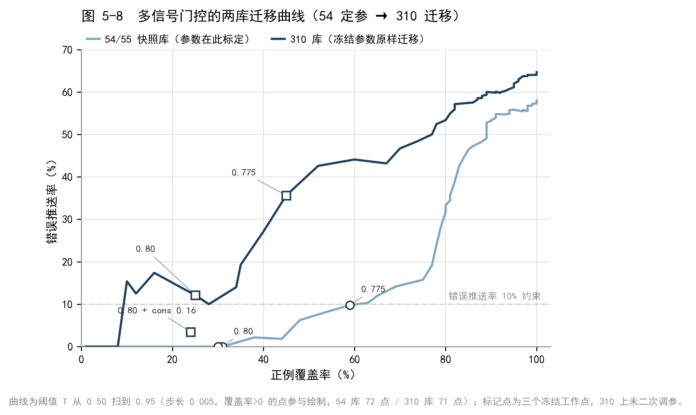

# 多信号门控原型（阈值 / margin / margin+根因一致性）

> 目的：单阈值在 310 库上已无可用工作点（0.78→27.1%、0.80→12.1%、0.82→0% 但正例覆盖仅 8%，见 [知识库310敏感性对照.md](知识库310敏感性对照.md)）。本文做一个**离线多信号门控原型**，回答三个问题：①不依赖绝对分数尺度的信号（间隔 margin、相对间隔 rel、批内 z-score、根因一致性 cons）能不能补上；②把参数**全部在 54/55 库上定死再原样搬到 310 库**，哪些信号可移植；③在「错误推送率 ≤10%」约束下，各配置能保住多少正例覆盖。
> 不做：不改在线代码、不上线、不重跑 M7 八轮、不重标定 310 阈值、不训练分类器。
> 执行日期：2026-11-07 ｜ 执行环境：VM `ubuntu-server`，纯离线重算（不调用 embedding / LLM，**成本 ¥0**） ｜ 产物：`docs/paper/评测/_multisignal/`

---

## 〇、一句话结论

> **margin / 相对间隔 / z-score 三种「相对量」在 310 库上同样不可移植**（54 上选定的 M=0.086 迁到 310 只推送 7 条、覆盖 3%、错误率 42.9%，因为正例的 top1−top2 间隔本身由 0.0822 缩到 0.0290，相对量随库规模一起漂移）；**唯一可移植的是「零错误绝对阈值 + 根因一致性」组合**——在 54 上定 0.80/0.16，原样迁到 310 得到**覆盖 24%、错误推送率 3.45%（29 推 1 错）**，而不加一致性时同阈值是 25%/12.1%。对照 0.75 单阈值在 310 的 74%/48.5%，覆盖率从 74% 降到 24%，属**精度优先模式**，不能写成「全面修复」。另需如实记录：用户要求的「margin + 根因一致性」组合在 54 上退化为 C=0.02（几乎不过滤），真正有效的是「阈值 + 一致性」这一支。

---

## 一、范围与口径

| 项 | 54/55 快照（标定库） | 310 库（验证库） |
|---|---|---|
| 样本 | 300 = 100 P + 100 N + 100 leave-gold-out | 同左（同一批 query 与负例） |
| 分数来源 | `_gate_raw.json` VECTOR 段（P/N top5）+ `_leave_out_after_cleanup.tsv`（LG top5） | `_kb310/_collect.json` + `_kb310/_lg_out.tsv` |
| 知识条目元数据 | `kb_310.csv` 命中 + `_kb_seed_snapshot.jsonl` 兜底解析「故障现象/可能原因」 | 同左（310 全部可命中，缺元数据 0 条） |
| 推送判定 | 规则为真 → 推送；P 正确 = top1 ∈ gold；N 正确 = `cls=="missing_noise"` 且 top1 ∈ usable；LG 恒错 | 同左 |
| 覆盖率 | P 推送数 / 100 | 同左 |
| 错误推送率 | 错误推送 / 总推送 | 同左（另给剔除 13 条失效负例口径） |
| 参数来源 | **全部在本列选**（阈值 T、margin M、相对 R、z Z、一致性 C、cons 权重） | **只读 54 的冻结参数，不二次调参** |

**最低推送量**：挑选工作点时要求 `push ≥ 30`，否则「覆盖 3%/错误 0%」这类退化解会被误选为最优。

---

## 二、四个信号的定义

| 信号 | 定义 | 是否依赖绝对分数 |
|---|---|---|
| `s1` | top1 余弦相似度 | 是 |
| `margin` | `s1 − s2`（top1 与 top2 的余弦差） | 否（相对） |
| `rel` | `(s1 − s2) / s1` | 否（相对） |
| `z` | `(s1 − μ) / σ`，μ、σ 取同批 top5 候选 | 否（批内标准化） |
| `cons` | 根因一致性，见下 | 否（文本一致性，与分数尺度无关） |

**cons 的算法（不训练分类器）**：

- 工单侧：正则抽取显式根因假设 `我怀疑是…导致`（只覆盖 N1 的构造模板），抽不到则退化为整条 query；
- 候选侧：取 top1 知识条目的 `root_cause`（旧条目从 `content` 的「可能原因」段解析）、`symptom`、`device_type`；
- 打分：无显式假设时 `cons = 0.5714·J(Q,S) + 0.2857·J(Q,R) + 0.1429·设备一致`；有显式假设时 `cons = 0.8·J(假设,R) + 0.2·J(Q,S)`（去掉设备项，否则 N1 会被设备命中抬高）；
- `J` 为字符二元组 Jaccard。**这是词面重合，不是向量语义相似**——选它是为了零依赖、可复现，代价是对同义改写不敏感（见 §七）。

**权重与 C 的确定方式**：18 组权重网格（sym 0.4/0.5/0.6 × rc 0.2/0.3/0.4 × dev 0.1/0.2）全部只在 54 上跑，取「≤10% 错误率下覆盖最大」的一组，得 `{sym 0.5714, rc 0.2857, dev 0.1429}`；C 在固定单信号门槛下按「错误率 ≤10% 且覆盖损失 ≤1pp」取最大，避免一致性门槛把覆盖率吃光。

---

## 三、曲线：错误推送率 vs 正例覆盖率

### 3.1 54/55 快照（标定库）

| 纯阈值 T | 覆盖率 | 推送 | 错误率 |
|---:|---:|---:|---:|
| 0.70 | 85% | 194 | 46.4% |
| 0.72 | 81% | 154 | 35.7% |
| 0.75 | 77% | 115 | 19.1% |
| 0.775 | 59% | 82 | 9.8% |
| 0.78 | 54% | 73 | 8.2% |
| 0.80 | 31% | 37 | 0.0% |
| 0.82 | 15% | 16 | 0.0% |

| margin M | 覆盖率 | 推送 | 错误率 |
|---:|---:|---:|---:|
| 0.010 | 92% | 214 | 46.3% |
| 0.020 | 88% | 173 | 37.0% |
| 0.030 | 83% | 149 | 30.2% |
| 0.040 | 78% | 129 | 24.0% |
| 0.050 | 73% | 119 | 23.5% |
| 0.060 | 67% | 103 | 18.4% |
| **0.086** | **47%** | **65** | **9.2%** |
| 0.100 | 37% | 52 | 9.6% |

| margin+cons（C=0.02） | 覆盖率 | 推送 | 错误率 |
|---:|---:|---:|---:|
| 0.020 | 83% | 149 | 30.9% |
| 0.040 | 78% | 121 | 19.8% |
| 0.050 | 73% | 113 | 19.5% |
| 0.060 | 67% | 99 | 15.2% |
| 0.070 | 60% | 87 | 11.5% |
| **0.086** | **47%** | **63** | **6.3%** |
| 0.100 | 37% | 50 | 6.0% |

| 阈值+cons（C=0.16，附加对照） | 覆盖率 | 推送 | 错误率 |
|---:|---:|---:|---:|
| 0.70 | 73% | 138 | 37.0% |
| 0.75 | 68% | 92 | 9.8% |
| 0.775 | 57% | 73 | 2.7% |
| 0.78 | 52% | 67 | 3.0% |
| **0.80** | **30%** | **36** | **0.0%** |
| 0.82 | 15% | 16 | 0.0% |

**读法**：在 54 上，三条曲线的形状几乎重合——同样 47% 覆盖时，纯阈值 9.8%、margin 9.2%、margin+cons 6.3%。也就是说 **54 上 margin 并不比阈值强，cons 也只多滤掉 2 条错误**；单阈值在这个库上本来就够用，这正是「两条腿在 54 上看不出差距」的原因。

### 3.2 310 库（冻结参数原样迁移）

| 纯阈值 T | 覆盖率 | 推送 | 错误率 |
|---:|---:|---:|---:|
| 0.70 | 87% | 234 | 58.6% |
| 0.75 | 74% | 165 | 48.5% |
| 0.775 | 45% | 87 | 35.6% |
| 0.78 | 40% | 70 | 27.1% |
| 0.80 | 25% | 33 | 12.1% |
| 0.82 | 8% | 9 | 0.0% |
| 0.85 | 1% | 2 | 0.0% |

| margin M | 覆盖率 | 推送 | 错误率 |
|---:|---:|---:|---:|
| 0.004 | 92% | 258 | 60.5% |
| 0.010 | 81% | 194 | 52.6% |
| 0.020 | 62% | 135 | 46.7% |
| 0.030 | 48% | 94 | 40.4% |
| 0.040 | 33% | 58 | 36.2% |
| 0.050 | 21% | 36 | 33.3% |
| 0.060 | 15% | 20 | 15.0% |
| **0.086（54 冻结点）** | **3%** | **7** | **42.9%** |

| margin+cons（0.086/0.02，54 冻结点） | 覆盖率 | 推送 | 错误率 |
|---:|---:|---:|---:|
| 0.004 | 84% | 217 | 53.9% |
| 0.010 | 76% | 170 | 45.9% |
| 0.020 | 61% | 120 | 40.0% |
| 0.030 | 48% | 86 | 34.9% |
| 0.040 | 33% | 55 | 32.7% |
| 0.050 | 21% | 33 | 27.3% |
| 0.060 | 15% | 19 | 10.5% |
| 0.086 | 3% | 6 | 33.3% |

| 阈值+cons（C=0.16，54 冻结） | 覆盖率 | 推送 | 错误率 |
|---:|---:|---:|---:|
| 0.70 | 73% | 166 | 49.4% |
| 0.75 | 64% | 122 | 36.1% |
| 0.775 | 43% | 72 | 23.6% |
| 0.78 | 38% | 60 | 16.7% |
| **0.80** | **24%** | **29** | **3.5%** |
| 0.82 | 8% | 9 | 0.0% |
| 0.85 | 1% | 2 | 0.0% |

**读法**：310 上四条曲线**整体上移**（同覆盖下多 20–30pp 错误）。margin 曲线在 310 上甚至不是单调的（M=0.06 为 15.0%，M=0.086 反弹到 42.9%），说明它不是「调阈值」问题，而是**信号本身与 310 的分数分布不匹配**。



**图 5-8　多信号门控的两库迁移曲线**　横轴正例覆盖率、纵轴错误推送率；两条曲线分别为 54/55 快照库（参数在此标定）与 310 库（冻结参数原样迁移），空心标记为 0.775、0.80、0.80+cons 0.16 三个工作点。**所有参数均在 54 库上定死、原样迁到 310 库，未在 310 上重新调参**——这是可移植性对比，不是两库各自最优；54 库上 0.80 与 0.80+cons 覆盖率仅差 1 pp（31% / 30%）且错误率均为 0，两点在图上几乎重合。数据来源：`docs/paper/评测/_multisignal/_multisignal_metrics.json`；n=300（P / N / leave-gold-out 各 100），曲线由阈值 0.50–0.95、步长 0.005 扫描得到（有效点 54 库 72 个 / 310 库 71 个）。

---

## 四、工作点建议（错误推送率 ≤10%）

### 4.1 54 上取点（参数在这里定）

| 配置 | 参数 | 覆盖率 | 推送 | 错误率 | 错误构成 |
|---|---|---:|---:|---:|---|
| 单阈值 best | T=0.775 | **59%** | 82 | 9.8% | N 8（同象异因 6、同因异象 2） |
| 单阈值 safe | T=0.80 | 31% | 37 | **0%** | — |
| margin best | M=0.086 | **47%** | 65 | 9.2% | N 6（同象异因） |
| margin+cons best | M=0.086, C=0.02 | **47%** | 63 | **6.3%** | N 4（同象异因） |
| 阈值+cons best | T=0.775, C=0.15 | **58%** | 74 | **2.7%** | N 2（同因异象） |
| 阈值+cons safe | T=0.80, C=0.16 | 30% | 36 | **0%** | — |
| rel best | R=0.116 | 44% | 62 | 9.7% | N 6 |
| rel+cons best | R=0.116, C=0.02 | 44% | 60 | 6.7% | N 4 |
| z | 54 上无 ≤10% 工作点 | — | — | — | 最低错误率仍 59% |

> 54 上「≤10%」的覆盖率排序：**阈值+cons 58% > 单阈值 59%（并列级）> margin+cons 47% > margin 47% > rel+cons 44%**。差距都在 1–2 条样本量级，**不能声称 margin 优于阈值**。
>
> 注：`阈值+cons best` 的 C=0.15 是按其自身「覆盖损失 ≤1pp」选出的，`阈值+cons safe` 的 C=0.16 按零错误点选出；§3.1 的曲线统一用 safe 支的 C=0.16 绘制，故 best 点（57%→58%）与曲线上同 T 点有 1pp 差异。

### 4.2 310 上验证（参数完全不动）

| 配置 | 冻结参数 | 覆盖率 | 推送 | 错误率 | 是否满足 ≤10% |
|---|---|---:|---:|---:|---|
| 0.75 单阈值（对照基线） | T=0.75 | 74% | 165 | **48.5%** | ❌ |
| 单阈值 | T=0.775 | 45% | 87 | 35.6% | ❌ |
| margin | M=0.086 | 3% | 7 | 42.9% | ❌ |
| margin+cons | 0.086 / 0.02 | 3% | 6 | 33.3% | ❌ |
| rel | R=0.116 | 2% | 6 | 50.0% | ❌ |
| rel+cons | 0.116 / 0.02 | 2% | 5 | 40.0% | ❌ |
| 单阈值 safe | T=0.80 | 25% | 33 | 12.1% | ❌ |
| **阈值+cons safe** | **0.80 / 0.16** | **24%** | **29** | **3.45%** | ✅（唯一） |
| 阈值+cons best | 0.775 / 0.15 | 45% | 77 | 27.3% | ❌ |

- 「阈值+cons safe」的 29 条推送 = 24 条正例（全对）+ 4 条负例（全对）+ 1 条 leave-gold-out（错）。**唯一漏网的是 1 条 LG**。
- 剔除 13 条扩库后失效负例的同口径：0.75 基线为 45.9%；阈值+cons safe 仅剩 1 条错误，落在 leave-gold-out 上，不受该口径影响。
- 作为「差距上限」参考：若允许在 310 上重新标定，单阈值 0.795 可做到 28% 覆盖 / 10.0% 错误；margin 在 310 上**没有任何 ≤10% 工作点**。这只是解释差距，不作为方案。

---

## 五、为什么可移植的是 cons，不是 margin

| 信号 | 54 中位数（P / N） | 310 中位数（P / N） | 变化 | 结论 |
|---|---|---|---|---|
| `s1` | 0.7831 / 0.7368 | 0.7710 / 0.7514 | 间隔 0.0463 → 0.0196 | 绝对量失效（已由 DEC-26 记录） |
| `margin` | 0.0822 / 0.0373 | 0.0290 / 0.0145 | **P 的间隔缩 2.8×、N 缩 2.6×** | 相对量同步漂移，M=0.086 只剩 3% |
| `rel` | — | — | 同 margin | 44% → 2% |
| `z` | 1.932 / 1.818 | 1.644 / 1.517 | 差 0.114 → 0.127 | 正负例几乎不可分，54 上就无工作点 |
| `cons` | 0.1913 / 0.0523 | 0.1887 / 0.0626 | **基本不变** | 与分数尺度无关，可移植 |

**机制解释**：

1. margin 是「同一信号的两个样本之差」，扩库后**所有样本的 top2 都被新条目抬高**（top2 变成同题新版本），P 的间隔因此被压缩得比 N 更狠；相对化只消除了「整体平移」，消不掉「间隔压缩」。
2. cons 比较的是**文本字段**（现象/根因/设备），库扩到 310 只是增加了候选，不改变「工单根因」与「命中条目根因」的字面重合度，所以分布几乎不动。
3. 但 cons 的判别力有限：310 上 P 的 cons 中位数 0.1887、LG 是 0.1631，**只差 0.0256**；这就是 24%/3.45% 里那 1 条 LG 漏网的原因，也是「加 cons 不能把错误率压到 0」的上限。

**对手要求的「margin+cons」为何没有成为答案**：在 54 上按「覆盖损失 ≤1pp」选 C，margin 分支的 C 只能取 0.02（再大就掉覆盖），等于几乎不过滤；迁到 310 后 margin 本身已经只剩 3% 覆盖，cons 再怎么加也救不回来。**结论应写成「margin 与 cons 都保留在原型里，但可迁移的组合是阈值+cons」**，不要写成「margin+cons 解决了问题」。

---

## 六、对论文的影响

### 6.1 可写 / 不可写

- ✅「本文实现了一个可开关的多信号门控原型：绝对阈值、top1−top2 间隔、相对间隔、批内 z-score 与根因一致性，并在两个知识库规模上做了冻结参数的迁移评估。」
- ✅「相对分数信号（间隔/相对间隔/z-score）不能解决库规模漂移：扩库后正例间隔由 0.082 压到 0.029，54 上选定的 0.086 迁移后覆盖率由 47% 降到 3%。」
- ✅「零错误阈值 0.80 叠加根因一致性门槛 0.16，在 310 库上以 24% 覆盖率取得 3.45% 错误推送率，是唯一满足 ≤10% 且参数未经二次调优的工作点。」
- ✅「作为代价，覆盖率由 0.75 门控的 74% 降至 24%，系统进入精度优先模式。」
- ❌「多信号门控把 310 库的错误率修回 19.1% 以下且保持 74% 覆盖。」
- ❌「margin 比单阈值更稳健。」（54 上两者差距在样本量级内，310 上 margin 更差）
- ❌「根因一致性由语义模型计算。」（当前实现是字符 bigram + 关键词规则）
- ⚠️ 暂定归属：「阈值+一致性」的可迁移性结论放**创新点四（门控）实现效果**；曲线与工作点放 **5.4 稳健性/敏感性**；「相对信号不可迁移」同时进 **5.6 局限 / 8 负结果**。若论文结构未定，这三处先按暂定标注。

### 6.2 对创新点四的定性

| 维度 | 结论 |
|---|---|
| 方法新颖性 | 中。多信号组合本身不新，新在「把问题二的根因抽取结果作为门控信号」并做了跨库冻结迁移验证 |
| 实现效果 | **有条件成立**：只有「阈值+一致性」可迁移，24% 覆盖 / 3.45% 错误；不是全面可用 |
| 主要风险 | 覆盖率代价大、cons 判别力窄（P 与 LG 中位数仅差 0.0256）、cons 仍是词面匹配 |

---

## 七、局限（必须随结果一起写）

1. **cons 是词面匹配**：字符 bigram Jaccard + 设备名精确匹配，未用 embedding 语义相似，也未训练分类器。同义改写（「膜片老化」vs「隔膜疲劳」）会漏判。换成语义相似可能提升，但**本轮未做，不得据此声称效果更好**。
2. **根因假设抽取只覆盖构造模板**：正则仅匹配「我怀疑是…导致」，真实工单的口语表达未验证；抽不到假设时退化为整条 query 与现象字段比对，判别力更弱。
3. **54 有 9 条 top1 元数据缺失**（P 3 / N 6，均为扩库时删除的旧条目），这些样本 cons 记 0，会**低估** 54 上的 cons 收益；310 无缺失，因此 54→310 的 cons 对比对 54 略不利。
4. **样本量与重数**：300 条单次运行，无置信区间、无重复测量；「1 条 LG」的差别在统计上不可区分。
5. **margin 曲线在 310 上非单调**（0.06 为 15.0%、0.086 为 42.9%），说明结果对具体门槛高度敏感，不支持任何「最优 M」的结论。
6. **未验证在线效果**：本文全部为离线重算，未改 `tims.kb.gate.*` 配置，也未做并发/延迟评估。

---

## 八、复现

```bash
cd /home/dev/ai-tims
python3 scripts/eval/gate_multisignal.py tune     # 只在 54 上定参 -> _multisignal_54.json
python3 scripts/eval/gate_multisignal.py apply    # 冻结参数迁到 310 -> _multisignal_310.json
python3 scripts/eval/gate_multisignal.py report   # 合并 -> _multisignal_metrics.json
python3 scripts/eval/gate_multisignal.py show     # 打印曲线与工作点
```

数据依赖（均为既有产物，无需重新采集）：`docs/paper/评测/_gate_raw.json`、`_leave_out_after_cleanup.tsv`、`_kb310/_collect.json`、`_kb310/_lg_out.tsv`、`_kb310/_negcheck.json`、`docs/paper/问题二/kb_310.csv`、`_kb_seed_snapshot.jsonl`。

产物与哈希（`docs/paper/评测/_multisignal/`，以 VM 上 `md5sum` 为准，本地与 VM 一致）：

| 文件 | 内容 | md5 |
|---|---|---|
| `_multisignal_54.json` | 54 标定：权重网格、各信号曲线、工作点 | `c97e446632b4ac0ee80baf1d5f207c8e` |
| `_multisignal_310.json` | 310 迁移：冻结参数逐规则结果、双口径曲线 | `2682cf23861ee83234d0cda955edf79e` |
| `_multisignal_metrics.json` | 两份合并的对外口径 | `8c375e27300589bfe0f27321419c1706` |
