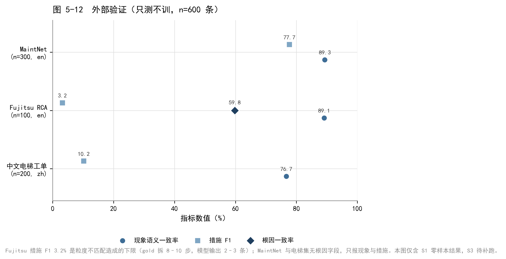

# 外部验证报告（R2：只测不训）

> **性质**：这是「外部真实工单集」上的**零样本抽取评测**，不是训练集，也不参与训练、去重、入库。
> **gold 口径**：由外部数据集**原文字段规则映射**构造（强/中两档），**不是人工标注**；所有指标只能称「与规则构造 gold 的一致性」，禁止写成人工标注一致率或 κ。
> **固定随机种子**：`20261106`；样本文件与哈希见 §1。
> **本轮约束**：未改动训练集、知识库、数据库与任何在线服务；样本只落在 `/tmp/ext-eval/`。

---

## 〇、一句话结论

**S1（glm-4-flash 零样本）在三个外部集上跑完 600 条：JSON 合法率 100%，现象语义一致率 76.7%–89.3%，MaintNet 措施 F1 77.7%，Fujitsu 根因一致率 59.8%（n=100）。S3（Qwen2.5-7B + LoRA）已跑完 600 条，进入复核**——产物 `pred_s3.jsonl`（600 条，md5 `122ae8d3b96934148336b0aa1a4c2b34`，11.8 min，JSON 合法 599/600）与 `metrics_s3.json` 已归档；复核项为口径一致性、prompt 对齐诊断的可复现性、与 `metrics_s1` 的同代码重算。**复核通过前，S3 数字按「复核中」引用，不写成最终结论。**

因此当前可写：「**在 MaintNet / Fujitsu / 中文电梯工单上完成了 S1 零样本与 S3 LoRA 的外部验证，S3 进入复核**」；S3 一列在复核通过后转为正式数字，**复核完成前不得写成「已通过」**。

---

## 一、数据获取与固定

| 数据集 | 来源链接 | 实际获取结果 | 全量规模 | 全量 md5 / 大小 | 抽样与哈希 | 语言 | 许可 |
|---|---|---|---|---|---|---|---|
| **MaintNet**（Aviation） | https://people.rit.edu/fa3019/technical/data/maintnet_aviation_dataset_deidentified.csv | **可直接下载**，HTTP 200 | 6,169 条（`IDENT,PROBLEM,ACTION`；文件 6,170 行 = 1 表头 + 6,169 数据行） | `85f68d73…2d24ac6c` / 504,992 B | 随机 300 条，`b51d9ae81ad12045d47507db41c7b244` | en | 学术使用（论文标注 MaintNet 出处） |
| **Fujitsu ManufacturingRCA** | https://hf-mirror.com/datasets/Fujitsu/ManufacturingRCA_Knowledge_Dataset（官方 HF 在本环境被墙，用镜像） | **可直接下载**，HTTP 200 | 100 条 | `aa49290d568c785733f837030fe16fe2` / 172,049 B | 全量 100 条，`b946844b5c6e446c05380c21dc2a4413` | en | CC-BY-4.0（须署名） |
| **中文电梯报修工单** | https://github.com/vs75yj9gzd-glitch/elevator-orders-public（`orders.json`） | **可直接下载**（zip / `codeload`） | 2,875 条、33 字段 | `949f2704068c7bd68ae6c530e9aee38a` / 4,976,420 B | 随机 200 条，`3cc8c0f6fb29c97cc5c14d20e35f8274` | zh | **仓库无 LICENSE 文件，授权不明**（只作研究引用，论文须注明来源与风险） |

评测输入文件（与上面子集一一对应）：

| 文件 | 条数 | md5 |
|---|---|---|
| `eval_maintnet.jsonl` | 300 | `619c173a6818ad42fea77ddb51822d61` |
| `eval_fujitsu.jsonl` | 100 | `b946844b5c6e446c05380c21dc2a4413` |
| `eval_elevator.jsonl` | 200 | `d7071fe0c54402b0896f30a251593e41` |

> 电梯集 200 条的字段可用性（抽样后实测）：`method` 17、`resolution` 28、`note` 83、`cause` 16、四者皆空 72 —— 这是后面「措施/根因样本量小」的根因。

> **MaintNet 规模口径（2026-11-10 回查原始文件）**：全量为 **6,169 条记录**，文件 **6,170 行**（含 1 行表头），504,992 B，md5 `85f68d7347861fad01a8b6982d24ac6c`（与首次下载记录逐字节一致）；`IDENT` 唯一 6,169、无重复主键、无空行、无引号内换行。文件内有 374 组重复的 `PROBLEM/ACTION` 组合（`IDENT` 不同），按记录口径仍计 6,169 条，不按内容去重。
> 另一处曾写 **6,168**（`外部数据集调研.md`、`开题报告.md`）：原因是 2026-11-06 记录的是 `wc -l`=6169，并把它当作文件总行数再减表头行；该文件**末行无换行符**，`wc -l` 少计 1 行（实际 6,170 行），故「行数 − 1」得到 6,168。**6,169 是记录数，6,168 是差一错误**，两处已统一为 6,169；抽样 300 条与全部指标不受影响。

---

## 二、字段映射表

| 数据集 | 外部字段 | → 五元组槽位 | 获取方式 | 强度 | 说明 |
|---|---|---|---|---|---|
| MaintNet | `PROBLEM` | symptom | 直接取原文 | **强** | 原文即现象描述 |
| MaintNet | `ACTION` | measures[ ] | 直接取原文 | **强** | 单条措施整句 |
| MaintNet | — | root_cause / verification / conditions | **不可得** | — | 该数据集无这些字段 |
| Fujitsu | `Incident_Summary` | symptom | 直接取原文 | **强** | 一句话标题式现象 |
| Fujitsu | `Detailed` | （仅作输入叙述，不作 gold） | — | — | 含排查过程，作为工单正文拼接 |
| Fujitsu | `Cause` | root_cause | 直接取原文（`<br>`/`-` 拆条） | **强** | 一条常含 2–3 个并列根因，评测取「任一命中」 |
| Fujitsu | `Immediate_Countermeasure` + `Permanent_Countermeasure` | measures[ ] | 直接取原文，按条拆分 | **强** | 一条工单常拆出 8–10 个步骤 |
| 电梯 | `content` | symptom（同时是输入正文） | 直接取原文 | **强** | 报修原文，含口语、楼栋号、对话碎片 |
| 电梯 | `method` | measures[ ] | 直接取原文 | **强** | 仅 17/200；且部分是「修复恢复」类状态词，已过滤 |
| 电梯 | `resolution` / `note` | measures[ ] | **规则兜底**（占位词过滤 + 分句） | **中** | 备注≠措施，噪声大 |
| 电梯 | `cause` | root_cause | 直接取原文 | **强（n=16）** | 样本太少，不作结论 |
| 三者 | — | verification / conditions / excluded_hypotheses | **不可得** | — | 外部集无对应标注，**不评、不报** |

---

## 三、评测的两个模型

### 3.1 S1：glm-4-flash 零样本（已完成）

- 与主实验盲评**完全同一段 INSTRUCTION**、`temperature=0`（贪心）、同一套 600 条输入；未使用 few-shot。
- 项目定义：S1 = 纯提示词零样本（glm-4-flash，现网）。**注意：S1 不是本地 Qwen 基座**，本地无权重。

### 3.2 S3：Qwen2.5-7B + LoRA adapter（**已跑完，进入复核**）

> **状态：已跑完，进入复核。** 600 条完整运行已完成（`pred_s3.jsonl`，600 条，md5 `122ae8d3b96934148336b0aa1a4c2b34`，11.8 min，JSON 合法 599/600）。复核项：口径一致性、prompt 对齐诊断的可复现性、与 `metrics_s1` 的同代码重算。复核通过前，S3 数字按「复核中」引用，**不写成最终结论**；全文中凡涉及 S3 外部结果的表述统一为该口径。

**执行环境**：单卡 RTX 4090 24GB（AutoDL，新实例），`transformers 4.46.3` + `torch 2.8.0+cu128` + `peft 0.21.2`，bf16，贪心解码（`do_sample=False`），`max_new_tokens=640`。adapter 为 `ckpt/qwen25-7b-lora-s3`（r=16、α=32、7 个投影层，1000 条 × 3 epoch，375 步，最终权重 md5 `7cbc1cfe310a7d74b3775bd5e9abb0fd`）。

**口径**：与 §3.1 **逐字相同的 INSTRUCTION**、同一批 600 条输入（文件 md5 见 §1，逐字节一致）、同一套打分代码（`ext_eval.py score`）。生成参数只有 `max_new_tokens` 不同（S1 走 API 不限长，S3 固定 640），其余一致。

| 项 | 实测 |
|---|---|
| 耗时 | 600 条 / **11.8 min**（batch=8，贪心；batch=1 单请求耗时见 `推理耗时基准.md`） |
| 峰值显存 | 15.60 GB |
| JSON 合法率 | 599/600 = **99.8%**（唯一失败为电梯集在 `conditions` 处被 640 截断） |
| 产物 | `pred_s3.jsonl`（600 条）md5 `122ae8d3b96934148336b0aa1a4c2b34` |

**⚠️ 关键诊断：主表里 S3 根因 0.0% 主要是「system prompt 与训练不一致」造成的，不是模型不会抽根因。**

- 主表按协议用 S1 的 INSTRUCTION 调 S3，而 S3 训练时用的是 `train_lora.py` 的 `SYSTEM_PROMPT`，两者措辞不同；微调后的模型对 system 段高度敏感，在陌生的 system 下**一律把 `root_cause` 输出为空串**（600/600 条），但在陌生 system 下现象/措施抽取仍正常。
- 把 Fujitsu 100 条改用**训练同款 SYSTEM_PROMPT**（user 内容不变）重测：JSON 合法 99/100、**根因非空 99/100、根因语义一致率 56.9%**（S1 为 59.8%）。样例：`metal fatigue caused by excessive force applied during a previous product jam`、`chain aging and wear due to insufficient lubrication`——与 gold 基本对应。
- 因此正确读法是：**S3 的根因能力在「训练同款 prompt」下与 S1 相当（56.9% vs 59.8%，n=100）**；主表的 0.0% 是**协议对齐的代价**（两模型同一 prompt），必须在论文里同时给出这两个数字，不能只报 0.0% 说"S3 不会抽根因"。
- 该诊断只跑了 Fujitsu 100 条（根因 gold 最全的集），未跑全 600 条，属**诊断性证据**，不作正式指标列。

**可复现性**：S3 列**只能在能加载 7B（≥16GB 显存、bf16）的机器上复现**；CPU 环境无 torch/权重，无法复现。本轮脚本与产物：`/tmp/ext-eval/gen_s3_ext.py`、`pred_s3.jsonl`、`metrics_s3.json`、`diag_fujitsu_train_system.json`（已同步到数据盘 `external_s3/` 与本地仓库）。

---

## 四、指标

> 匹配口径（与主实验一致）：自由文本用字符 bigram Jaccard 与 SequenceMatcher 取大；措施用 best-match（阈值 0.6）算 Recall/Precision/F1；根因对「多条并列」取任一命中 max。
> **JSON 合法率** = 能解析出 JSON 对象的比例；**字段齐全率** = 6 个核心键齐全的比例；**核心字段非空率** = symptom 与 measures 都非空的比例。

### 4.1 总表（S1 零样本 vs S3 微调，同一 600 条、同一 INSTRUCTION、同一 JSON 口径）

> 两列的**唯一变量是模型**：S1 = glm-4-flash 零样本；S3 = Qwen2.5-7B + LoRA（r=16/α=32，1000 条×3 epoch）。
> 两者使用**逐字相同的 system INSTRUCTION**（`scripts/annotation/ext_eval.py` 的 `INSTRUCTION`）、`temperature=0`，user 内容均为「工单：\n」+ 原文，因此差值可读作"微调带来的跨域变化"。
> 已知不对称：S3 训练时的 system prompt 是 `train_lora.py` 的 `SYSTEM_PROMPT`，与本条 INSTRUCTION 措辞不同（见 §3.2 末的诊断）。



**图 5-12　外部验证**　MaintNet / Fujitsu / 中文电梯三个外部集上的现象语义一致率与措施 F1；本图仅含 S1（glm-4-flash 零样本）结果，S3 见 §4.1 表（已跑完，复核中）。数据来源：`docs/paper/问题二/外部验证报告.md` §4.1（`pred_glm.jsonl`）；n=600（300 / 100 / 200）。

> **状态说明（统一口径）**：下表中 S3 三行标为**「复核中」**，数字来自已完成的 600 条运行，复核通过前不作为最终结论引用；现阶段可稳定引用的是 S1 三行。复核完成后删除本行、并同步 §0/§3.2/§6/§7/§9。

| 数据集 | 方案 | n | JSON 合法率 | 字段齐全率 | 核心字段非空率 | 现象语义一致率 | 措施 Recall | 措施 Precision | 措施 F1 | 根因语义一致率 |
|---|---|---|---|---|---|---|---|---|---|
| MaintNet | S1 | 300 | 100.0% | 100.0% | 89.3% | **89.3%** | 77.7% | 77.7% | **77.7%** | 不可得 |
| MaintNet | **S3（复核中）** | 300 | 100.0% | 100.0% | **100.0%** | **96.5%** | 80.3% | 76.4% | **77.7%** | 不可得 |
| Fujitsu | S1 | 100 | 100.0% | 100.0% | 100.0% | **89.1%** | 1.8% | 13.0% | **3.2%** | **59.8%**（n=100） |
| Fujitsu | **S3（复核中）** | 100 | 100.0% | 100.0% | 100.0% | **89.3%** | 0.9% | 4.3% | **1.5%** | **0.0%**†（n=100；训练同款 prompt 诊断 56.9%） |
| 电梯（中文） | S1 | 200 | 100.0% | 100.0% | 61.5% | **76.7%** | 9.8% | 10.9% | **10.2%** | 5.2%（n=16，不作结论） |
| 电梯（中文） | **S3（复核中）** | 200 | 99.5% | 99.5% | 99.5% | **66.8%** | 5.5% | 4.3% | **4.6%** | **0.0%**†（n=16，不作结论） |

> **† 根因 0.0% 必须与诊断同时出现**：主协议沿用 S1 的 INSTRUCTION，与 S3 训练时的 `SYSTEM_PROMPT` 不一致，导致 `root_cause` 全空（600/600）；换回**训练同款 SYSTEM_PROMPT** 后 Fujitsu 根因非空 99/100、语义一致率 **56.9%**（S1 为 59.8%，n=100）。因此 0.0% 是**协议对齐的代价**，不能单独引用来证明「S3 不会抽根因」。

附：严格逐字一致率（现象）分别 2.0% / 5.0% / 1.0%——自由文本改写是常态，故以语义一致率为准。
输出语言跟随率（预测与原文同为中文/英文）：99.0% / 100% / 100%（MaintNet 有 3 条把英文答成中文）。

附（S3）：严格逐字一致率（现象）3.3% / 0.0% / 5.0%；语言跟随率 100% / 100% / 99.5%；唯一一条非 JSON 是电梯集输出在 `conditions` 处被 `max_new_tokens=640` 截断。
复现哈希：`pred_s3.jsonl`（600 条）md5 `122ae8d3b96934148336b0aa1a4c2b34`；`pred_glm.jsonl` md5 `63e05960c72d26a585f7cd568af1cbd5`。产物路径 `/tmp/ext-eval/`。

**600 条运行的三条发现（复核中）：**

1. **S3 在主协议下 `root_cause` 一律输出空串**（三个集非空条数均为 0）。这不是解析失败——JSON 合法率 99.8%、字段齐全率同为 99.8%。但**换回训练同款 SYSTEM_PROMPT 后 Fujitsu 根因非空 99/100、一致率 56.9%**（S1 59.8%），说明 0.0% 是**协议未对齐**（主协议沿用 S1 的 INSTRUCTION），不能单独解读为「模型不会抽根因」。对照 S1：Fujitsu 100/100 都给出根因（59.8%），MaintNet（gold 无根因）却编造了 93 条。因此 S3 的 0.0% 必须与上述诊断成对出现，并在论文中作为「跨域 + prompt 分布敏感」的负向结果报告。
2. **现象抽取不劣于 S1，MaintNet 上明显更好**（89.3% → 96.5%，核心字段非空率 89.3% → 100%），主要因为 S1 有 3 条把英文答成中文导致字面相似度归零，而 S3 语言跟随率 100%。
3. **措施 F1：MaintNet 持平（77.7% vs 77.7%），Fujitsu/电梯下降**（3.2% → 1.5%、10.2% → 4.6%）。Fujitsu 的 gold 是 8–10 步流程，S3 输出更短更笼统；电梯集在原文措施（强，n=17）上 S3 为 34.3%，与 S1 的 35.3% 基本持平。

### 4.2 分来源强度（措施）

| 数据集 | 强度 | n | 至少命中 1 条 | Recall | Precision | F1 |
|---|---|---|---|---|---|---|
| MaintNet | 强 | 300 | 77.7% | 77.7% | 77.7% | 77.7% |
| Fujitsu | 强 | 100 | 16.0% | 1.8% | 13.0% | 3.2% |
| 电梯 | 强（method 原文） | 17 | 41.2% | 32.4% | 41.2% | **35.3%** |
| 电梯 | 中（resolution/note 规则） | 111 | 6.3% | 6.3% | 6.3% | 6.3% |

> **强度差异是可解释的**：强字段（原文措施）一致率 35%–78%；规则兜底的「中」字段只有 6.3%——说明 `note/resolution` 并不是措施，用它当 gold 会把指标压到底，不应据此评价模型。

### 4.3 根因（仅 Fujitsu 可报）

| 口径 | 数值 | n |
|---|---|---|
| 任一命中（gold 多根因取 max） | **59.8%** | **100** |
| 整串一致 | 39.7% | 100 |
| 严格逐字一致 | 0.0% | 100 |

> **n=100 必须标注**：这是全量，不是抽样，但只有 100 条、且 100% 来自同一篇 Fujitsu 内部案例集，不能外推为通用根因能力。

### 4.4 明确不报的指标

| 指标 | 原因 |
|---|---|
| 排除假设误抽率 | 三个外部集**均无** excluded_hypotheses 标注，无法计算 |
| 三关系判别（同象异因等） | 外部集无「同象异因」配对标注，构造配对会变成自造 gold，**不报** |
| verification / conditions 一致率 | 无对应字段，**不可得** |
| κ / 人工一致性 | 无第二标注者，gold 是规则构造，**禁止**用 κ 表述 |

---

## 五、失败样例（每集 3 条，均为实际输出）

### MaintNet（英文，跨语言与角色混淆是主因）

| ID | 原文（截断） | gold 现象 | 预测现象 | 问题 |
|---|---|---|---|---|
| MN022 | `INSPECTED & FOUND CRANKSHAFT TO BE GOUGED...` / `INSTALLED CRANKSHAFT OIL SEAL.` | INSPECTED & FOUND CRANKSHAFT TO BE GOUGED BEHIND CRANKSHAFT | 曲轴后部磨损 | 语义对，但**答成中文**，字面相似度归零 |
| MN118 | `ALL 4 ROCKER COVERS LEAKING ON R/H ENGINE.` | ALL 4 ROCKER COVERS LEAKING ON R/H ENGINE. | 4个摇臂盖在右侧发动机上漏水 | 翻译导致 bigram 只有 0.04；措施拆得比 gold 更细（3 条） |
| MN208 | 现象 + 处置两段 | PERFORMING GROUND REF MAN, THROTTLE WAS AT 1600 RPM... | Exhaust valve guides ... were reamed | **把 ACTION 当成了现象**，measures 输出空 → 角色混淆 |

### Fujitsu（gold 是 8–10 步作业流程，模型只给 2–3 条概括）

| ID | 现象（预测 vs gold） | 措施差异 | 问题 |
|---|---|---|---|
| INC094 | pred: cooling capacity suddenly decreased… / gold: Processing D line cooling device malfunction | gold 3 步（急停断电、定位堵塞换热器清洗、降温）；pred 2 条（clean the heat exchanger / improve cooling water quality） | gold 句子长、含流程动作，best-match 0.6 阈值下算不中 |
| INC099 | pred: cooling capacity suddenly decreased, washing fluid temperature rose | gold 3 步（急停、查漏点、补冷媒）；pred 2 条（replace aging piping / improve inspection） | 语义相关但动词不同，被计为未命中 |
| INC093 | pred: cooling capacity decreased, laser oscillator temperature rose | gold 3 步（急停、换泵、降温）；pred 2 条（replace pump / regular maintenance） | 同上，粒度不对齐 |

> 这三条**不是抽错样本**，而是该集措施 gold 的天然粒度：一条工单拆 8–10 步，模型输出 2–3 条要点。故 3.2% 只能当**下限**，不能读成「模型措施几乎全错」。

### 电梯（数据本身是聊天碎片，gold 不是现象）

| ID | 原文 | gold 现象 | 预测现象 | 问题 |
|---|---|---|---|---|
| `43b4d2f2…` | `得去看了吗？是坏还是线路短路` | 同左（原文） | 设备无法正常工作 | 原文是**提问**不是故障现象；模型做了泛化 |
| `b1af7fa1…` | `> 19栋1单元9楼 好了` | 同左 | 设备故障 | 原文是**完工回复**；gold 本身不成立 |
| `2069a045…` | `现在用不了了，我在负一楼了 一楼外呼板一` | 同左 | 设备无法使用 | 原文被截断，现象不完整 |

> 这正是「核心字段非空率 61.5%」的来源：200 条里有 72 条四类措施字段全空，且大量为对话碎片。**该集只能用于「中文现象抽取」的鲁棒性观察，不能用于措施/根因评测。**

---

## 六、局限（必须在论文 Limitations 写）

1. **n 小且集中**：Fujitsu 全量仅 100 条、单一来源；电梯有效措施只有 17 条（强）+111 条（中）。根因结论只能写「在该集上」。
2. **领域偏移**：MaintNet 是**航空维修**、Fujitsu 是**流程工业（热处理/清洗/激光）**、电梯是**特种设备维保**；与 SMT/精密电子制造不同。跨领域只能证明「方法可迁移」，不能证明「SMT 精度」。
3. **gold 是规则构造，不是人工标注**：现象/措施/根因来自原文字段，属强监督；电梯 `resolution/note` 属弱监督（中），已单独报。
4. **指标对粒度敏感**：Fujitsu 措施 gold 是 8–10 步流程，模型输出 2–3 条要点，best-match 0.6 阈值下会系统性偏低；**该数字是下限**。
5. **跨语言**：英文集有 1% 的样本被答成中文，字面指标直接归零；这是语言跟随问题，不是抽取错误。
6. **S3 已跑完、复核中；S3 对 system prompt 高度敏感**：主协议（与 S1 同一 INSTRUCTION）下 S3 根因 0.0%，换成训练同款 SYSTEM_PROMPT 后 Fujitsu 恢复到 56.9%（n=100）；该 0.0% 与诊断必须成对出现。若复核通过，说明微调模型的跨域鲁棒性依赖 prompt 分布，不能声称"微调提升了跨域泛化"（MaintNet 现象 +7.2pt、措施持平；Fujitsu/电梯措施反而下降）。
7. **S3 的评测只在能加载 7B 的 GPU 机器上可复现**：≥16GB 显存的 bf16 环境；CPU 环境无 torch、无权重，无法复现该列。

---

## 七、答辩可说 / 不可说

**可说**：
- 「除 1000 条构造集外，我们在 **MaintNet 300 条、Fujitsu ManufacturingRCA 100 条、中文电梯工单 200 条**上做了**只测不训**的外部验证，S1 共 600 条，同一 INSTRUCTION、同一套打分；S3 一列**已跑完、复核中**（600 条，11.8 min，JSON 合法 599/600）。」
- 「S1 的现象语义一致率为 76.7%–89.3%，MaintNet 措施 F1 77.7%，Fujitsu 根因一致率 59.8%（n=100）。」
- 「外部集验证的是**方法可迁移性**，不是 SMT 场景精度；SMT 场景精度仍以构造集 + 留出集为准。」

**不可说**：
- ❌「S3 外部验证已完成 / 已通过」——S3 已跑完但复核未完成，只能写「已跑完，进入复核」。
- ❌ 单独引用「S3 根因 0.0%」而不附训练同款 prompt 诊断——必须同时给出「Fujitsu 换回训练同款 SYSTEM_PROMPT 后根因非空 99/100、一致率 56.9%」。
- ❌「用真实工单训练/微调」——外部集只测不训。
- ❌「根因 F1 59.8%，达到生产可用」——n=100、单来源、规则 gold。
- ❌「排除假设抽取在外部集上也有效」——该指标不可得，未测。
- ❌「三关系判别在外部集上验证」——无配对标注。

---

## 八、复现命令与成本

```bash
# 1) 取数（/tmp/ext-eval 与 /tmp/dataset-research 已固定；哈希见 §1）
# 2) 构造评测集（规则映射，生成 gold 与强度标签）
python3 scripts/annotation/ext_eval.py build
# 3) S1 零样本评测（temperature=0，与主实验同一 INSTRUCTION）
python3 scripts/annotation/ext_eval.py run --workers 6 --model glm-4-flash --tag glm
# 4) 打分
python3 scripts/annotation/ext_eval.py score --tag glm
```

- 正式评测：**600 次调用**，prompt 146,130 + completion 130,423 = **276,553 tokens**，glm-4-flash 按 0.1 元/百万计 ≈ **¥0.028**。
- 本轮另含两次口径试跑（一次语言指令版、一次冒烟），合计约 1,300 次调用、≈ **¥0.06**，均已废弃，不作为结论。

---

## 九、结论

R2（外部验证）在 **S1 与 S3 两侧均已完成 600 条运行**；S1 已定稿，S3 进入复核：

- 三个外部集都能下载、能引用、能映射到现象/措施/根因三个槽位，S1 600 条全部跑通；
- 能支撑的指标：现象语义一致率、措施一致率（强/中分开）、Fujitsu 根因一致率（n=100）；S3 一列已跑完、复核中，复核通过后引用；
- 不能支撑的指标：排除假设、三关系、验证结果、适用条件——外部集不可得，已在 §4.4 与 §7 明确；
- S3 在留出集上的数字见 `S3评测_heldout.md`（该处为同分布留出集，不是外部集），推理耗时见 `推理耗时基准.md`；S3 外部集结论按「已跑完，进入复核」口径，复核后回填。
