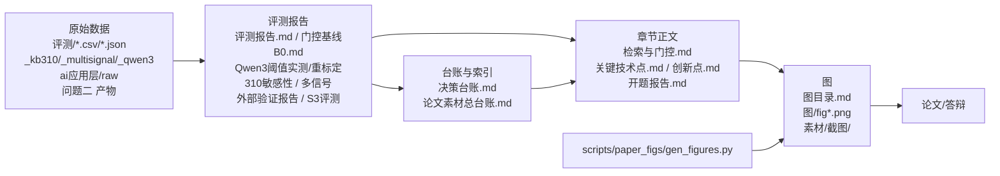

# 12 目录与素材说明

> 采集时间：**2026-11-23 13:57（Asia/Shanghai）**
> 数据来源：`git status --porcelain -uall -- docs/paper`、`git diff --numstat -- docs/paper`、`Get-ChildItem` 实际枚举。所有数字均为当时实查，未凭印象补写。
> 适用范围：`docs/paper` 的未提交改动分类、`docs/paper` 目录职责、仓库顶层目录职责、引用依赖图、过期清单。

---

## 一、`docs/paper` 未提交改动（2026-11-23 实查）

### 1.1 总量

| 项 | 数量 |
|---|---|
| 未提交条目总数 | **320** |
| 已修改（` M`） | **12**（全部是 md） |
| 新增未跟踪（`??`） | **308** |
| 删除（`D`） | **0** |
| 已跟踪文件 | **76** |
| 其中未改动 | **64**（76 − 12） |
| 被 gitignore 忽略 | **4**（`问题二/外部验证S3产物/*.log`，不计入未跟踪） |

按扩展名拆未跟踪项：

| 扩展名 | 数量 | 主要位置 |
|---|---|---|
| png | 166 | `图/` 20、`素材/截图/` 144、`评测/_qwen3/evidence/` 2 |
| json | 70 | `ai应用层/` 28、`ai应用层/raw/` 24、`评测/` 系 12、`问题二/` 系 6 |
| md | 34 | 根目录、`ai应用层/`、`评测/`、`问题二/`、`研究方向/`、`素材/` |
| csv | 21 | `ai应用层/raw/` 19、`素材/_来源映射.csv`、`问题二/外部验证S3产物/rows_S3_merged.csv` |
| jsonl | 8 | `问题二/关系判别/` 6、`问题二/外部验证S3产物/` 1、`问题二/链式抽取/` 1 |
| tsv | 3 | `评测/_kb310/` 2、`评测/_leave_in.tsv` 1 |
| docx | 1 | `开题报告_学校模板.docx` |
| py | 4 | `问题二/外部验证S3产物/` |
| ps1 | 1 | `图/scripts/redraw_qwen3_gate.ps1` |

> 注意：直接跑 `git status --short` 只会显示 157 条，因为未跟踪目录被折叠；必须加 `-uall` 才是 320 个文件。另有 4 个 `.log` 被 gitignore 忽略，普通 `git status` 看不到。

### 1.2 12 个已修改 md（正式结论类）

| 文件 | 增/删行 | 性质 |
|---|---|---|
| `docs/paper/决策台账.md` | +366 / -4 | DEC 决策台账，最高权威口径 |
| `docs/paper/关键技术点.md` | +4 / -0 | 技术点正文草稿 |
| `docs/paper/评测/评测报告.md` | +13 / -4 | 评测正文 |
| `docs/paper/评测/门控基线B0.md` | +14 / -0 | 门控基线正文 |
| `docs/paper/评测/评测集说明.md` | +1 / -1 | 评测集口径 |
| `docs/paper/评测/方法与调优说明.md` | +4 / -0 | 方法与调优正文 |
| `docs/paper/问题二/外部验证报告.md` | +63 / -27 | 外部验证正文（改动最大） |
| `docs/paper/问题二/外部数据集调研.md` | +30 / -12 | 外部集调研 |
| `docs/paper/问题二/S3评测_heldout.md` | +13 / -0 | S3 heldout 评测 |
| `docs/paper/问题二/知识库扩容说明.md` | +4 / -0 | 扩容记录 |
| `docs/paper/问题二/README.md` | +1 / -0 | 问题二入口 |
| `docs/paper/研究方向/技术路线四步_v2_问题二.md` | +14 / -6 | 技术路线 v2 |

判断依据：均在正文/台账/评测报告路径，被 `图目录.md`、`论文素材总台账.md`、`决策台账.md` 互相引用；`docs/paper` 根目录与 `评测/`、`问题二/` 的一级 md 都属于论文可直接引用的正文层。

### 1.3 未跟踪 md（34 个）中的正式类

| 目录 | 文件 |
|---|---|
| `docs/paper/` 根 | `创新点.md`、`参考文献.md`、`图目录.md`、`开题报告.md`、`开题报告_大白话解读.md`、`检索与门控.md`、`研究过程札记.md`、`论文素材总台账.md` |
| `ai应用层/` | `可观测性与Key管理.md`、`护栏.md`、`护栏评测报告.md`、`缓存.md`、`缓存评测报告.md`、`路由.md`、`路由修复.md`、`路由敏感性与错误代价.md`、`路由评测报告.md` |
| `评测/` | `Qwen3Embedding门控阈值实测结果.md`、`Qwen3Embedding阈值重标定.md`、`多信号门控原型.md`、`知识库310敏感性对照.md` |
| `问题二/` | `C档兜底建议与处置配对记录.md`、`三项方法落地状态与S3增益拆解.md`、`推理耗时基准.md`、`盲评κ重算_修复后.md`、`关系判别/关系判别评测.md`、`链式抽取/链式抽取评测.md`、`链式抽取/prompts.md` |
| `研究方向/` | `技术路线四步_v1.md`、`数据与基线决策_v1.md`（**旧版，v2 为准**） |
| `素材/` | `截图索引.md`、`关键信息索引.md` |
| 非正式 | `评测/_qwen3/续接记录.md`（过程记录）、`问题二/外部验证S3产物/metrics_s3.md`（产物说明） |

### 1.4 临时/中间产物（**属原始数据，不可清理**）

| 组 | 数量 | 判定依据 |
|---|---|---|
| `评测/_baseline_compare.json`、`评测/_leave_in.tsv` | 2 | 下划线前缀 = 工作文件；`10`/`11` 已注明该约定 |
| `评测/_kb310/`（5 json + 2 tsv） | 7 | 目录名带 `_`；为 310 库敏感性对照的采集/诊断/指标原始件 |
| `评测/_multisignal/`（3 json） | 3 | 下划线目录；多信号门控 54/310 原始指标 |
| `评测/_qwen3/`（2 json） + `evidence/`（2 png） | 4 | 下划线目录；`检索与门控.md`、`关键信息索引.md`、`Qwen3Embedding门控阈值实测结果.md` 直接引用 evidence 图 |
| `ai应用层/raw/`（24 json + 19 csv） | 43 | `raw/` = 逐条原始行；`路由修复.md` 等直接引用 |
| `ai应用层/` 根 28 json | 28 | `*_freeze.json` 是冻结快照（`路由修复.md` 引用）；`*_set_stats.json`、`*评测.json`、`裸模型_*` 是评测汇总原始值 |
| `问题二/关系判别/`（6 jsonl + 1 json） | 7 | 逐条预测；`研究过程札记.md` P-14 引用 `relation_pred_*_full.jsonl` |
| `问题二/外部验证S3产物/`（5 json + 1 csv + 1 jsonl + 4 py + 4 log + 1 md） | 16 | S3 原始预测/指标/脚本/日志；`决策台账` C-15/M-035、`研究过程札记` 引用 `pred_s3.jsonl` |
| `问题二/链式抽取/`（1 json + 1 jsonl） | 2 | `metrics.json`、`pred_chain.jsonl` 为链式评测原始件 |
| `素材/_来源映射.csv` | 1 | 下划线前缀；截图与来源的映射表 |
| `图/` 20 png | 20 | 正文插图，由 `scripts/paper_figs/gen_figures.py` 与 `图/scripts/redraw_qwen3_gate.ps1` 生成，`图目录.md` 引用 |
| `图/scripts/redraw_qwen3_gate.ps1` | 1 | Qwen3 门控图重绘脚本；小体积、可复现，建议随图一并保留 |
| `素材/截图/` 144 png | 144 | 过程截图，按日期归档，`素材/截图索引.md` 逐张索引 |

> 这些文件虽然按命名算「工作文件」，但都是**可复算的原始数据**，删掉后无法从报告反推。**只读保留，不要清理**。

### 1.5 分类依据汇总

1. **文件名约定**：`_` 前缀（文件或目录）= 中间产物；`raw/` = 逐条原始行；`*_freeze.json` = 冻结快照。
2. **是否被正文引用**：被 `图目录.md`、`素材/截图索引.md`、`决策台账.md`、`研究过程札记.md`、`检索与门控.md`、`路由修复.md` 明确引用者，即使带下划线也不能删。
3. **是否进入素材台账**：`论文素材总台账.md` 的 M-xxx/C-xx 条目引用了 `_gate_live.json`、`pred_s3.jsonl` 等原始件。
4. **git 跟踪状态**：`评测/gate_baseline.csv`、`threshold_eval.csv`、`_gate_live.json`、`_scores_positive.json` 属于**已跟踪且未改动**的 64 个文件之一，不在本轮 320 项里。
5. **忽略状态**：`问题二/外部验证S3产物/` 的 4 个 `.log` 被 gitignore 忽略，既不算跟踪也不列为未跟踪；必须用 `--ignored` 才能看到。

---

## 二、目录职责清单

### 2.1 `docs/paper/`（388 文件 / 87.70 MB，唯一原件）

| 目录 | 文件数 | 放什么 | 谁产生 | 被谁引用 | 上游依赖 | 下游给谁 |
|---|---|---|---|---|---|---|
| `docs/paper/`（根） | 11 | 正文草稿（关键技术点/创新点/开题）、三大台账（决策/素材）、检索与门控、图目录、参考文献 | 人工写作 | 全包引用 | 评测/问题二产出 | 论文正文、`public/11` 索引 |
| `ai应用层/` | 37（28 json + 9 md） | 路由/缓存/护栏/可观测性正文与评测 json、冻结快照 | `scripts/ai_layer/*` | `关键技术点.md`、`创新点.md` | `scripts/ai_layer/`、模型调用记录 | 章节正文 |
| `ai应用层/raw/` | 43（24 json + 19 csv） | 逐条评测原始行（路由/工具计算/护栏/确定性触发/裸模型） | `scripts/ai_layer/*.py` | `ai应用层/*.md` | 线上/离线模型调用 | 汇总指标 json |
| `评测/`（根） | 28（9 json + 9 md + 5 tsv + 5 csv） | 门控阈值、基线、评测集说明、错误率评估、310 敏感性、多信号门控 | `scripts/eval/*.py` | `检索与门控.md`、`图目录.md`、`决策台账.md` | 知识库快照 + 检索接口 | 章节正文、图 |
| `评测/_qwen3/` | 3（2 json + 1 md） | Qwen3 embedding 换模后的阈值重标定原始件与续接记录 | `scripts/eval` + 人工 | `Qwen3Embedding阈值重标定.md`、`10`/`11` | 换模后重跑 | 阈值结论 |
| `评测/_qwen3/evidence/` | 2 png | 间隔规则扫描证据图 | 评测脚本 | `检索与门控.md`、`素材/关键信息索引.md`、`Qwen3Embedding门控阈值实测结果.md` | `_qwen3` 评测 | 正文插图（图号待定） |
| `评测/_kb310/` | 7（5 json + 2 tsv） | 310 库采集/诊断/gold 校验/负例校验原始件 | `scripts/eval/kb310_sensitivity.py` | `知识库310敏感性对照.md` | 310 库快照 | 敏感性正文 |
| `评测/_multisignal/` | 3 json | 多信号门控 54/310 指标 | `scripts/eval/gate_multisignal.py` | `多信号门控原型.md` | 门控评测 | 门控正文 |
| `问题二/`（根） | 40（18 md + 9 jsonl + 6 json + 5 csv + 1 js + 1 html） | 抽取/关系判别/链式/外部验证/盲评/扩库正文与产物 | 人工 + `scripts/annotation/*` | `论文素材总台账.md`、`决策台账.md` | 工单抽取结果 | 第 5 章、创新点 |
| `问题二/关系判别/` | 8（6 jsonl + 1 md + 1 json） | 变体/替代关系逐条预测与评测 | `scripts/annotation/blind_eval.py` 等 | `关系判别评测.md`、`研究过程札记.md` | 关系标注集 | 关系判别结论 |
| `问题二/链式抽取/` | 4（2 md + 1 json + 1 jsonl） | 链式抽取评测、提示词原文、预测 | `scripts/annotation/chain_extract.py` | `链式抽取评测.md` | 线上链式抽取 | 抽取章节 |
| `问题二/S3评测/` | 12（5 py + 3 jsonl + 3 csv + 1 json） | S1–S3 分阶段评测脚本与结果 | 评测脚本 | `S3评测_heldout.md` | 外部集 | 外部验证正文 |
| `问题二/外部验证S3产物/` | 16（5 json + 4 log + 4 py + 1 csv + 1 jsonl + 1 md） | S3 600 条外部集预测、指标、脚本、日志 | GPU 机器实跑 | `外部验证报告.md`、`决策台账` C-15/M-035、`研究过程札记.md` | 外部数据集 | 外部验证结论 |
| `问题二/backup/` | 2 gz | 310 扩容前知识库 SQL 备份 | 扩库前人工备份 | `知识库扩容说明.md` | 310 之前库 | 回滚/审计 |
| `研究方向/` | 4 md | 标注手册、技术路线四步 v1/v2、数据与基线决策 v1 | 人工 | `决策台账.md`、`问题二/` | 早期方案 | 技术路线（v2 为准） |
| `素材/` | 3（2 md + 1 csv） | 截图索引、关键信息索引、来源映射 | 人工 | 全包引用 | 截图归档 | 正文/答辩 |
| `素材/截图/<日期>/` | 144 png | 11-02～11-19 过程截图，按日期分 10 个目录 | 实际操作截屏 | `素材/截图索引.md` | 部署/评测/调试过程 | 正文插图、答辩 |
| `图/` | 20 png | 正文插图 | `scripts/paper_figs/gen_figures.py`、`图/scripts/redraw_qwen3_gate.ps1` | `图目录.md` | 评测/正文数据 | 论文正文 |
| `图/scripts/` | 1 ps1 | Qwen3 门控图重绘脚本 | 人工 | 无 | 图数据 | `图/fig19`、`fig20` |

### 2.2 仓库顶层目录（2026-11-23 实查）

| 目录 | 文件数 | 职责 | 谁在用 | 活跃度 | 过期/注意 |
|---|---|---|---|---|---|
| `ai-tims-parent/` | 283 | 后端 Maven 多模块 | 开发/发布 | 活跃 | — |
| `ai-tims-front/` | 12043（含 `node_modules`/`dist`） | Vue 前端 | 开发/发布 | 活跃 | 构建产物 `dist`、`node_modules` 不入库 |
| `deploy/` | 39 | K8s 清单、发布脚本（`k8s/`、`sdv1/`、`scripts/`、`docker/`） | 发布 | 活跃 | 以 `overlays/company` 为准 |
| `docs/` | 467 | 交接/运维/论文/计划/截图/SQL | 全员 | 活跃 | 见 2.3 |
| `scripts/` | 112 | 评测、标注、建库、镜像、论文图脚本 | 开发/论文 | 活跃 | — |
| `sql/` | 3 | `init.sql`、`upgrade_ai_observe.sql` | DBA/部署 | 低频 | 增量脚本在 `docs/sql/` |
| `images/` | 7 | 三个新镜像包 + 旧包 + MANIFEST | 发布 | 待清理 | 与「不再放仓库 images/」约定冲突 |
| `public/` | 13 | 交接包（README + 01–12） | 接手方 | 活跃 | 不含 paper 副本 |
| `docker/` | 3 | 本地 compose 与 Dockerfile | 本地联调 | 低频 | — |
| `models/` | 10（169.21 MB） | `lora_s3` adapter 权重 | 外部验证 | 低频 | 大文件，勿进 Git |
| `2026-11-19/` | 103（1.16 MB） | `memory-sync` 同步产物 | 会话工具 | 临时 | 非项目交付物 |
| `2026-11-20/` | 79（392.94 MB） | `trae-bao-sync` 同步产物 | 会话工具 | 临时 | 大体积，非交付物 |
| `.eval_out/` | 9 | 本地评测临时输出（TestGuard） | 调试 | 临时 | 可清 |
| `.screenshots/` | 0 | 空目录 | — | 废弃 | 可清 |
| `.github/` | 1 | `workflows` | CI | 低频 | — |

### 2.3 `docs/` 一级

| 目录 | 文件数 | 职责 | 状态 |
|---|---|---|---|
| `docs/paper/` | 388 | 论文唯一原件 | 活跃 |
| `docs/ops/` | 25 | 公司环境操作记录、发布流程、资产清单、搭建手册 | 活跃；`公司环境资产清单.md` 部分数值待核实 |
| `docs/plan/` | 1 | 开发计划与进度 | 部分过期（见第四节） |
| `docs/handover/` | 1 | 环境与版本对照 | 部分过期（见第四节） |
| `docs/screenshots/` | 38（6.61 MB） | M6 前后对比截图 | 历史留档 |
| `docs/sql/` | 13 | 增量 SQL 迁移 | 历史留档 |

### 2.4 `ai-tims-parent/` 模块

| 模块 | 端口 | 职责 |
|---|---|---|
| `ai-tims-common` | — | 公共依赖、工具、DTO |
| `ticket-gateway` | 8080 | 统一网关 |
| `ticket-system` | 8101 | 登录/用户/系统 |
| `ticket-order` | 8102 | 工单与流转 |
| `ticket-knowledge` | 8103 | 知识库、Milvus、检索门控 |
| `ticket-ai` | 8104 | AI 对话、抽取、链式抽取 |
| `ticket-push` | 8105 | 推送、WebSocket |

### 2.5 `scripts/` 与 `deploy/` 子目录

| 目录 | 文件数 | 职责 | 状态 |
|---|---|---|---|
| `scripts/ai_layer/` | 50（含 `data/`、`java/`） | 路由/缓存/护栏/裸模型评测与构建脚本 | 活跃 |
| `scripts/annotation/` | 13 | 标注、盲评、κ、链式抽取脚本 | 活跃 |
| `scripts/eval/` | 11 | 评测集生成、门控评测、310 敏感性、多信号 | 活跃 |
| `scripts/finetune/` | 3 | LoRA 微调说明与训练脚本 | 低频 |
| `scripts/images/` | 6 | 镜像 build/save/load/push 脚本 | 发布时用 |
| `scripts/kb/` | 21（含 `data/`） | 建库、导入、审计、Milvus 压缩 | 低频 |
| `scripts/paper_figs/` | 1 | `gen_figures.py`，生成 `docs/paper/图/` | 写论文时用 |
| `deploy/k8s/` | — | base + overlays（company） | 发布唯一入口 |
| `deploy/sdv1/` | — | `deploy.sh` 等公司侧发布脚本 | 发布时用 |
| `deploy/docker/` | — | 镜像构建相关 | 低频 |
| `deploy/scripts/` | — | 辅助脚本 | 低频 |

`ai-tims-front/` 结构：`src/` 源码、`dist/` 构建产物、`node_modules/` 依赖；后两者不入库。

---

## 三、阅读/引用依赖图



改一个数的同步顺序（以门控/检索分数为例）：

1. 原始数据：`评测/gate_baseline.csv`、`threshold_eval.csv`、`_gate_live.json`、`_scores_positive.json` 或 `_kb310/`、`_qwen3/`；
2. 评测正文：`评测/评测报告.md`、`门控基线B0.md`、`Qwen3Embedding*`、`知识库310敏感性对照.md`；
3. 台账：`决策台账.md`（DEC 条目）、`论文素材总台账.md`（M/C 条目）；
4. 章节：`检索与门控.md`、`关键技术点.md`、`创新点.md`；
5. 图：`图目录.md` 图注 + `scripts/paper_figs/gen_figures.py` 重生成 `图/`；
6. 交接包：`public/10`、`public/11` 的汇总行。

> 只改报告不改原始数据，或只改正文不改台账，都会造成同一数字多处不一致。

---

## 四、过期/慎用清单

| 文档/目录 | 判断 | 依据 |
|---|---|---|
| `docs/plan/开发计划与进度.md` | 部分过期，引用前核对 | `public/10` §3.6：已重盘但知识库 328、待审 85 等仍是旧口径 |
| `docs/handover/环境与版本对照.md` | 部分过期 | `public/10` §3.6：已更正为 kubeadm 1.23.17 / 7 节点，其余数值需现场核实 |
| `docs/ops/公司环境资产清单.md` | 部分过期 | `public/10` §3.6：镜像 1.0.1/1.0.2、`front.yaml` 已补，但知识库 311/328 两说并存 |
| `docs/paper/研究方向/技术路线四步_v1.md`、`数据与基线决策_v1.md` | 旧版 | 已有 `_v2` / 后续决策；引用以 v2 与 `决策台账.md` 为准 |
| `docs/paper/评测/_qwen3/续接记录.md` | 过程记录，非结论 | 文件名与内容为续接日志 |
| `评测/_gate_*.json`、`_scores_*.json`、`_*.tsv` | 工作文件但**不可清理** | 是原始数据，`10`/`11` 已注明 |
| `docs/paper/问题二/S3评测_heldout.md` 中「未跑」旧表述 | 慎用 | `决策台账` DEC-25/C-15：S3 已跑完，统一为「已跑完，进入复核」 |
| 任何 322/319/311 条知识库、85 条待审 | 作废 | 2026-11-23 MySQL 实查 328 全 PUBLISHED、`PENDING_REVIEW=0` |
| `images/` 中的三个新包 | 与约定冲突 | `docs/ops/发布流程.md` §5.1「不再放仓库 images/」 |

---

## 五、提交与忽略建议

> 以下是**建议**，本轮未执行任何 git 操作，也未改动 `docs/paper`。

### 5.1 建议提交

- **12 个已修改 md**：`决策台账.md`、`关键技术点.md`、`评测/评测报告.md`、`门控基线B0.md`、`评测集说明.md`、`方法与调优说明.md`、`问题二/外部验证报告.md`、`外部数据集调研.md`、`S3评测_heldout.md`、`知识库扩容说明.md`、`问题二/README.md`、`研究方向/技术路线四步_v2_问题二.md`。
- **34 个正式 md**（正文/评测/索引）与 `开题报告_学校模板.docx`。
- **`图/scripts/redraw_qwen3_gate.ps1`**：12,655 B，可复现 `fig19/fig20`，建议随图提交。
- 已跟踪的评测主数据（`gate_baseline.csv`、`threshold_eval.csv`、`_gate_live.json`、`_scores_positive.json`）保持现状，不要重复添加。

### 5.2 建议忽略 / 不入库

- 已忽略：`docs/paper/问题二/外部验证S3产物/*.log`（4 个，keep 现状）。
- 建议加入 `.gitignore`：`.eval_out/`、`.screenshots/`、`2026-11-19/`、`2026-11-20/`、`ai-tims-front/node_modules/`、`ai-tims-front/dist/`、`models/lora_s3/`、`images/*.tar.gz`。
- **不要**整体忽略 `docs/paper/**/_*.json`、`_*.tsv`、`raw/`：这些是报告无法反推的原始数据，即使带下划线也要提交或另行归档。

### 5.3 大文件

- `models/lora_s3/`：10 个文件、**169.21 MB**；`2026-11-20/`：79 个文件、**392.94 MB**；`images/` 三个新包也在百 MB 级。
- 建议：**都不进 Git**，放外部存储或公司侧目录，仓库内只留 `MANIFEST` 与校验值。
- **LFS 不建议**：这些是一次性交付物，不是需要长期版本化的源码；启用 LFS 会增加克隆与 CI 负担。只有在必须把 adapter 纳入版本历史时才考虑，并同时设置配额。

### 5.4 CRLF

- 当前 12 个修改 md 会被 git 提示 `LF will be replaced by CRLF`。
- 建议加 `.gitattributes`：`* text=auto`，对 `*.md`、`*.csv`、`*.json` 明确 `eol=lf`；然后执行 `git add --renormalize .` 统一一次。
- 不要在提交前单独改换行符，否则会把内容改动和换行改动混在一起，难以回滚。

---

## 六、实查命令（可复跑）

```bash
git status --porcelain --ignored -uall -- docs/paper
git diff --numstat -- docs/paper
git diff --stat -- docs/paper
git ls-files -- docs/paper | wc -l
```

```powershell
Get-ChildItem -Recurse -File docs/paper | Measure-Object Length -Sum
Get-ChildItem -Recurse -Directory docs/paper
```

---

## 七、实查中与预期不符

1. **目录名是 `关系判别`，不是 `关系识别`**：`docs/paper/问题二/` 下实际为 `关系判别/`（8 个文件）。
2. **未提交条目是 320 个，不是 157**：`git status --short` 会折叠未跟踪目录；必须 `-uall`。
3. **166 张 png 全部未跟踪**：包括 `图/` 的 20 张正文插图也从未提交过；`docs/paper` 的图片层整体未入库。另有 4 个 `.log` 被 gitignore，需 `--ignored` 才可见。
4. **`问题二/` 子目录比预期多**：除 `链式抽取/`、`关系判别/` 外，还有 `S3评测/`（12）、`外部验证S3产物/`（16）、`backup/`（2 个 gz）。
5. **仓库顶层出现 `2026-11-19/`、`2026-11-20/`、`.eval_out/`、`.screenshots/`、`models/lora_s3/`**：前两者是会话同步产物（11-20 占 392.94 MB），`models/lora_s3` 为 169.21 MB adapter；均非论文交付物。
6. **git 反复提示 LF→CRLF**：`docs/paper` 的 12 个修改文件存在换行符将被转换的警告，提交前需统一。
